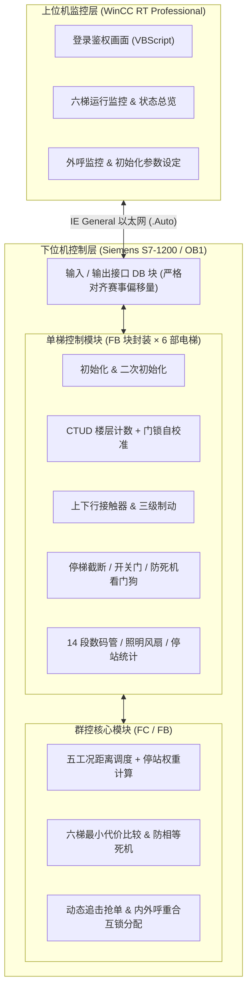
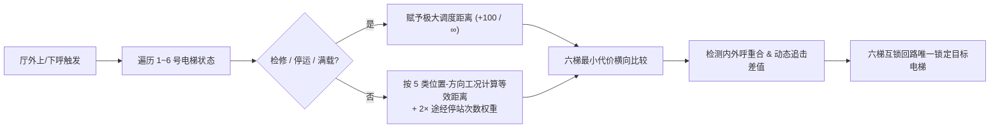

# 六部十层电梯群控系统设计与实现（Siemens S7-1200 & WinCC）

<p align="left">
  <a href="./README_EN.md"></a>
  
  
  
  
</p>

> **6-Elevator 10-Floor Group Control System** based on **Siemens S7-1200 PLC (LAD / FB / FC / DB)** and **WinCC RT Professional HMI (VBScript)** — developed for the *“Siemens Cup” China Intelligent Manufacturing Challenge (Discrete Industry Automation – Logic Algorithm Track)*.  
> 👉 **[Click here for English Documentation (README_EN.md)](./README_EN.md)**

一套基于**西门子博途（TIA Portal）S7-1200 PLC** 与 **WinCC RT Professional** 开发的**六部十层群控电梯完整工程设计文档**（含 **107 张高清梯形图/组态截图** 与 VB 脚本源码解析）。原系列文章首发于个人技术博客（累计阅读超 2.5 万次），现完整整理开源至 GitHub，**永久免费开放阅读**。

---

## ✨ 核心工程亮点

- **模块化 FB/FC 存储优化架构**：将单梯通用控制逻辑封装为参数化 `FB` 函数块，由 `FC` 块对 1~6 号电梯集中实例化调用，配合分类 `DB` 数据块管理，有效避免六梯并发下的 PLC 工作存储器过载。
- **闭环自校准楼层计数**：基于端限标定 + `CTUD` 加减计数器，结合 `#截上` / `#截下` 方向互锁与**门锁信号实时误差校准**，彻底消除平层抖动导致的楼层漂移。
- **提前一层减速与三级平滑制动**：区分 5 类停靠工况提前一层切换低速，配合延时时序投入一/二/三级制动，兼顾运行效率与平层准确度（零冲顶/零碰第二限位）。
- **防死机状态机与看门狗保护**：采用 `停梯截断`（控停）与 `完成开门关门`（控动）双变量解耦；内置 **10s 轿厢滞留唤醒**、**20s 运行卡死看门狗**、**单层 3 次开关门上限** 与 **检修动态二次初始化**。
- **改进型 SSTF 群控调度与动态追击抢单**：综合计算五类工况下的楼层距离、双倍停站次数权重与满载惩罚；支持运行中**电梯追击动态重分配（Pursuit Optimization）**、**内外呼重合顺路并单**及单梯一键群控隔离。
- **WinCC 全流程监控与 VBScript 登录鉴权**：涵盖 7 大监控画面、双向变量绑定、IE General 以太网组态及基于 `SmartTags` / `ActivateScreenByNumber` 的登录鉴权脚本。

---

## 🏗️ 系统架构与调度流程

### 1. 软硬件工程架构



### 2. 外呼群控调度决策流程



---

## 📚 全系列章节目录

建议按照以下**自底向上（系统准备 → 单梯控制 → 群控算法 → 上位机 HMI）**的工程顺序阅读：

| 阶段 | 章节 | 核心内容概述 | 配图数 |
| :--- | :--- | :--- | :---: |
| **工程准备** | [第 1 篇：赛题分析与程序准备](docs/01-competition-analysis-and-setup.md) | Day 1/2 赛题拆解、分层停靠与启停控制、4 处关键 IP 与 PG/PC 接口配置、OB/FC/FB/DB 架构设计 | 15 |
| **单梯控制** | [第 2 篇：初始化](docs/02-initialization.md) | 正常三参数初始化、NORM_X/SCALE_X 载重转换、第一限位换向、检修隔离与单梯动态二次初始化 | 11 |
| **单梯控制** | [第 3 篇：楼层计算](docs/03-floor-calculation.md) | `CTUD` 加减计数原理、门锁信号楼层误差闭环校准、`#截上` / `#截下` 防误计锁存机制 | 9 |
| **单梯控制** | [第 4 篇：信号显示](docs/04-signal-display.md) | `a~n` 14 段数码管译码、满载与故障指示灯互锁逻辑、轿厢照明与风扇控制 | 4 |
| **单梯控制** | [第 5 篇：电梯上下行运动](docs/05-up-down-motion.md) | 上下行接触器控制、`刚刚在上下行` 信号冲突防卡顿恢复、防反向内呼点亮、满载关灯与滞留检测 | 12 |
| **单梯控制** | [第 6 篇：高低速转换与制动](docs/06-speed-switching-and-braking.md) | 5 类减速停靠工况、提前一层切换低速、高低速电气互锁、三级延时平稳制动系统 | 5 |
| **单梯控制** | [第 7 篇：停梯优先级响应与开关电梯门](docs/07-stop-priority-and-doors.md) | 双变量“停/动”解耦控制、自动开关门三阶段状态机、20s 死机看门狗、单层 3 次开门限制 | 9 |
| **群控核心** | [第 8 篇：停梯次数计算](docs/08-stop-count.md) | 单层停梯标志置位与清零、3~10 层区间停站枚举累加、折返停站次数统计（`CALCULATE`） | 6 |
| **群控核心** | [第 9 篇：群控调度算法](docs/09-dispatch-algorithm.md) | 改进 SSTF 五类距离计算公式、停站权重放大防冲突、电梯追击动态抢单、内外呼重合互锁分配 | 12 |
| **上位机 HMI** | [第 10 篇：WinCC 组态与 VB 脚本讲解](docs/10-wincc-hmi-vbscript.md) | PC 站与 IE General 组态、7 大监控画面设计、`denglu` 登录验证完整 VBScript 源码与分辨率排错 | 24 |
| **理论附录** | [附录：群控电梯调度算法综述](docs/appendix-dispatch-algorithms.md) | 传统调度（FCFS / SSTF / SCAN / LOOK / SATF）、实时调度（EDF / SCAN-EDF / PI / FD-SCAN）与现代智能群控对比 | — |

---

## 📂 仓库目录结构

```text
siemens-cup-elevator-group-control/
├── README.md                 # 中文项目主页
├── README_EN.md              # English Project Overview
├── LICENSE                   # CC BY-NC-SA 4.0 知识共享许可协议
└── docs/                     # 10 篇完整工程文档 + 调度算法综述附录
    ├── 01-competition-analysis-and-setup.md
    ├── ...
    ├── 10-wincc-hmi-vbscript.md
    ├── appendix-dispatch-algorithms.md
    └── images/               # 按章节归档的 107 张本地高清梯形图与组态截图
```

---

## 🤝 交流与许可说明

- 如有技术细节疑问或改进建议，欢迎直接提交 [GitHub Issue](../../issues) 讨论。
- 本仓库全部图文与代码解析采用 **[CC BY-NC-SA 4.0](LICENSE)**（署名-非商业性使用-相同方式共享 4.0 国际）协议开源：**永久免费公开，欢迎学习参考与注明出处的非商业转载，严禁任何平台或个人将其设为付费/VIP 专享或用于商业售卖。**
