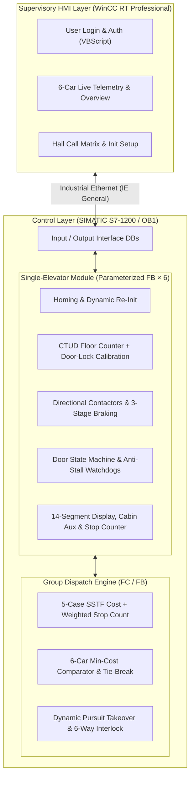

# 6-Car 10-Floor Elevator Group Control System (Siemens S7-1200 & WinCC)

  
  
  
  
  
  

Complete **TIA Portal V18 project source (`src/整合/整合.ap18`)** and 11-part engineering design series for a **6-car, 10-floor elevator group control system**, built with **Siemens TIA Portal V18**, **SIMATIC S7-1200 (Ladder Logic / FB / FC / DB)**, and **WinCC RT Professional (HMI + VBScript)** for the *“Siemens Cup” China Intelligent Manufacturing Challenge (Discrete Industry Automation – Logic Algorithm Track)*.

> 📦 **One-Click Project Download**: Grab `Siemens-Cup-6Car-10Floor-Elevator-TIA-V18.zip` directly from the **[Releases Page](https://github.com/h491218554-creator/siemens-cup-elevator-group-control/releases)**, or open [`src/整合/整合.ap18`](src/整合/整合.ap18) in **Siemens TIA Portal V18** (STEP 7 Professional V18 + WinCC RT Professional V18).

---

## 🔧 Key Engineering Highlights

1. **Memory-Efficient Modular PLC Architecture (`OB1 → FC → 6× FB + Categorized DBs`)**
   - Encapsulates single-car control logic into reusable Function Blocks (`FB`) instantiated across 6 elevators via `FC` calls, preventing S7-1200 work-memory overflow while allowing rapid competition-day reconfiguration (zoned floor stops, online car enable/disable).
2. **Closed-Loop Floor Tracking & Self-Calibration**
   - Combines limit-switch homing, `CTUD` up/down counters, directional anti-bounce interlocks (`#截上` / `#截下`), and **door-lock feedback calibration** to eliminate cumulative floor-counting drift.
3. **3-Stage Smooth Braking & Pre-Floor Deceleration**
   - Evaluates 5 stopping scenarios to switch from high-speed to low-speed contactors (electrically interlocked) one floor ahead of target stops, followed by sequential 3-stage timed braking for repeatable, overshoot-free leveling.
4. **Decoupled Door State Machine & Fault-Tolerant Watchdogs**
   - Decouples stopping priority (`停梯截断`) from restart permission (`完成开门关门`) to prevent cyclic scan deadlocks.
   - Built-in **20 s stall recovery watchdog**, **10 s idle-passenger detection**, **3-cycle door reopen limit**, and **single-car dynamic re-initialization** after maintenance release.
5. **Modified SSTF Group Dispatching with Dynamic Pursuit Optimization**
   - Evaluates an equivalent dispatch cost across 5 relative position/direction cases, incorporating **2× intermediate stop-count weighting** and **full-load penalties** (`+100` / `∞` for isolated cars).
   - Implements real-time **Pursuit Re-dispatching** (allowing a faster non-stop car to take over a hall call from a slower stopping car) and **Hall/Car Call Coincidence Merging** with 6-way mutual-exclusion locking.
6. **WinCC RT Professional SCADA/HMI & VBScript Authentication**
   - 7 operator screens connected via `IE General` Ethernet (`.Auto` PG/PC interface), bidirectional HMI–DB tag binding, and VBScript user authentication (`SmartTags`, `ActivateScreenByNumber`) with error-code diagnostics (`E0001` / `E0002`).

---

## 🗺️ System Architecture

---

## 📖 Documentation Index (Chinese with 107 LAD & HMI Diagrams)

| Module | Chapter | Topics Covered | Figures |
| :--- | :--- | :--- | :---: |
| **Setup & Arch** | [01 – Problem Analysis & Project Setup](docs/01-competition-analysis-and-setup.md) | Competition Day 1/2 requirements, zoned stops, 4-node IP & PG/PC setup, OB/FC/FB/DB design | 15 |
| **Single Car** | [02 – Initialization & Homing](docs/02-initialization.md) | 3-parameter startup, `NORM_X`/`SCALE_X` load scaling, 1st-limit reversal, maintenance isolation & dynamic re-init | 11 |
| **Single Car** | [03 – Floor Calculation & Calibration](docs/03-floor-calculation.md) | `CTUD` up/down counter, door-lock position self-correction, directional anti-miscount latches | 9 |
| **Single Car** | [04 – Indicators & Cabin Signals](docs/04-signal-display.md) | 14-segment (`a–n`) display decoding, full-load vs. fault indicator rules, lighting & fan control | 4 |
| **Single Car** | [05 – Up/Down Motion Control](docs/05-up-down-motion.md) | Contactor interlocks, anti-stall state memory, reverse-call rejection, full-load call release & idle-passenger handling | 12 |
| **Single Car** | [06 – Speed Switching & 3-Stage Braking](docs/06-speed-switching-and-braking.md) | 5 deceleration cases, 1-floor lookahead low-speed switch, 3-stage timed braking | 5 |
| **Single Car** | [07 – Stop Priority, Doors & Watchdogs](docs/07-stop-priority-and-doors.md) | Two-variable stop/motion decoupling, 3-phase door cycle, 20 s stall watchdog, 3-time door reopen cap | 9 |
| **Group Dispatch** | [08 – Intermediate Stop Counting](docs/08-stop-count.md) | Per-floor stop latching/clearing, floor 3–10 cumulative stop enumeration & turnaround stop calculation | 6 |
| **Group Dispatch** | [09 – Group Dispatching Algorithm](docs/09-dispatch-algorithm.md) | 5-case SSTF cost formulas, stop-weight amplification, dynamic pursuit takeover, hall/car call coincidence interlock | 12 |
| **HMI / SCADA** | [10 – WinCC Configuration & VBScript](docs/10-wincc-hmi-vbscript.md) | PC station & `IE General` Ethernet setup, 7 HMI screens, VBScript login validation & runtime resolution tuning | 24 |
| **Appendix** | [Appendix – Survey of Group Dispatch Algorithms](docs/appendix-dispatch-algorithms.md) | Comparison of FCFS, SSTF, SCAN, LOOK, SATF, EDF, SCAN-EDF, PI, FD-SCAN & AI-based group control | — |

---

## 🧩 PLC Program Block Architecture (`src/整合/整合.ap18`)

| Subsystem | Reusable Function Block (`FB`) | 6-Car Caller Function (`FC` / `OB`) | Instance / Global `DB` | Doc Chapter |
| :--- | :--- | :--- | :--- | :--- |
| **Main Cycle & I/O** | — | `Main` (`OB1`) | `输入变量` (Inputs), `输出变量` (Outputs), `中间变量1/2` | [Ch. 01](docs/01-competition-analysis-and-setup.md) |
| **Homing & Re-Init** | `初始化 嵌套` | `初始化 函数` | `初始化 嵌套_DB` | [Ch. 02](docs/02-initialization.md) |
| **Floor Counter & Calibration** | `计算楼层 嵌套` | `计算楼层 函数` | `计算楼层 嵌套_DB` | [Ch. 03](docs/03-floor-calculation.md) |
| **14-Seg Display & Cabin Aux** | `照明，风扇，数码管 嵌套` | `照明，风扇，数码管 函数` | `照明，风扇，数码管 嵌套_DB` | [Ch. 04](docs/04-signal-display.md) |
| **Motion & 3-Stage Braking** | `上下行和制动 嵌套` | `上下行和制动 函数` | `上下行和制动 嵌套_DB` | [Ch. 05](docs/05-up-down-motion.md) / [Ch. 06](docs/06-speed-switching-and-braking.md) |
| **High/Low Speed Switching** | `高低速 嵌套` | `高低速 函数`, `低速模式` | `高低速 嵌套_DB_1` | [Ch. 06](docs/06-speed-switching-and-braking.md) |
| **Stop Priority & Door Control** | `停梯优先级和开关门 嵌套` | `停梯优先级和开关门 函数` | `停梯优先级和开关门 嵌套_DB` | [Ch. 07](docs/07-stop-priority-and-doors.md) |
| **Intermediate Stop Counter** | `停站次数 嵌套` | `停站次数 函数` | `停站次数 嵌套_DB_1` | [Ch. 08](docs/08-stop-count.md) |
| **Call Target Detection** | `有无目标判断嵌套块` | `有无目标判断` | `有无目标判断嵌套块_DB_1` | [Ch. 09](docs/09-dispatch-algorithm.md) |
| **SSTF Dispatch Cost Calc** | `调度距离嵌套块` | `调度距离` | `调度距离嵌套块_DB_1` | [Ch. 09](docs/09-dispatch-algorithm.md) |
| **Min-Cost Comparator & Lock** | `比较筛选分配嵌套块` | `比较筛选` | `比较筛选分配嵌套块_DB` | [Ch. 09](docs/09-dispatch-algorithm.md) |
| **Supervisory HMI** | `PC station` (7 Screens + `denglu` VBScript) | — | Bidirectional HMI Tag Table | [Ch. 10](docs/10-wincc-hmi-vbscript.md) |

---

## 📄 License

Licensed under **[CC BY-NC-SA 4.0](LICENSE)** (Creative Commons Attribution-NonCommercial-ShareAlike 4.0 International).
