# 第 1 篇：赛题分析与程序准备

> 原文发表于 2023-07-30，迁移至 GitHub 时进行了排版整理与附图本地化。

## 一、赛题分析

### Day 1

Day 1 的赛题与 2022 年并无区别，需要注意的就是 WinCC 里的界面细节要求。例如本次初赛要求在电梯运行监控画面中载重量后标明单位 `Kg`，其实只需拉一个文本域添加即可。

### Day 2

Day 2 的赛题以及 WinCC 的变化稍大，需要一定时间修改，如果细心 Day 2 很容易满分（50 分）。

> **注意**：在 2023 年初赛 Day 2 比赛中并无 EET 工程文件，是由裁判根据比赛评分表上的步骤对程序进行评判。

**程序方面：**

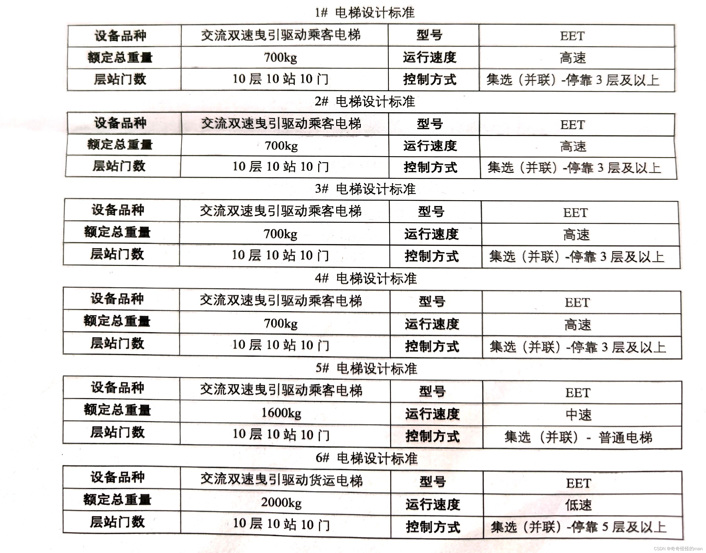

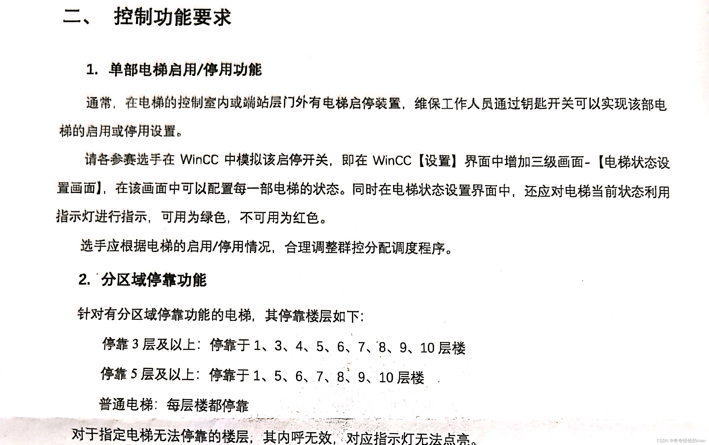

程序部分与控制界面部分有两个点需要修改：**分层停靠**、**启停控制**。

#### 1. 分层停靠

- 对于不予停靠的楼层，每部电梯目标：外呼不分配，内呼不响应（内呼指示灯不亮）。
- 在 Day 2 比赛中仍然会重新划分电梯的分层区域，需要参赛者现场修改。

#### 2. 启停控制

> **注意**：在 2023 年初赛中电梯并未在运动中启停，而是在初始化楼层后即进行启停电梯选择。

重点在于程序控制界面（WinCC）与 PLC 的变量数据双向传输：
- 可以使用 DB 块新建启停开关变量、允许停止标志位，并将其连接到 HMI 变量中的同名变量（增加可读性）。
- 当上下平层接触器置 `1`、上下行接触器置 `0` 的情况下进行**群控分离**（该变量会在[初始化篇](02-initialization.md)中介绍）。

---

## 二、上位机与下位机的连接

我们在初赛选择的是 **S7-1200**：

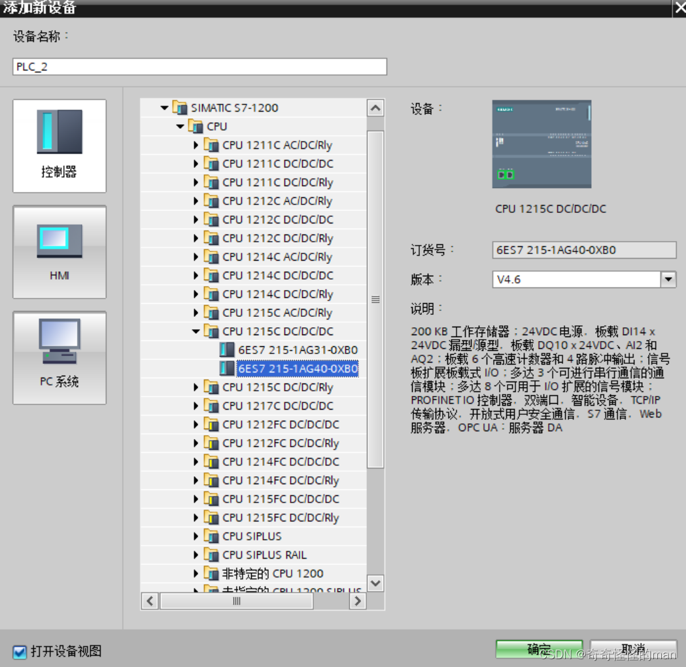

> **注意**：固件版本号尽量选择 V4.2 或 V4.1 版本，能够高低同时兼容。

选择以下 WinCC 设备：

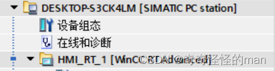

### 配置 IP 地址（重点）

共有 **4 个 IP 地址**需要我们调整，要保证**前三个网段相同，最后一个网段不同**：

1. **第一个**：查看训练或比赛中电脑的以太网网段。例如下位机地址为 `192.168.0.10`，就要保证前三个网段一致（例如第三段为 `2` 时统一对齐为同一网段）。
2. **第二个**：博途（TIA Portal）内部的以太网地址：

   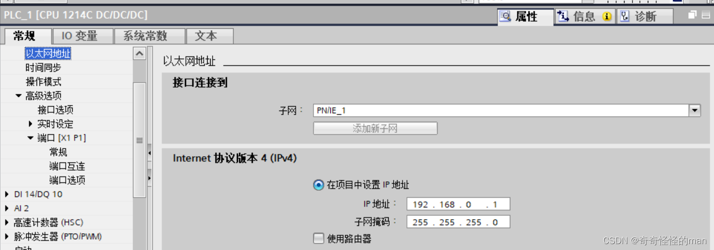

3. **第三个**：上位机（自己电脑连接接口）的 IP 地址，可以固定为 `192.168.0.250`（靠后的地址冲突概率较小）。
4. **第四个**：WinCC 与 PLC 直接通信的网段：

   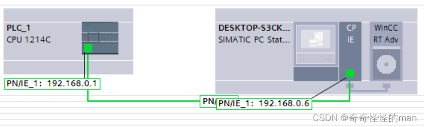

### 下载与在线连接

配置好 IP 地址后即可尝试连接下位机，点击下载并复位：

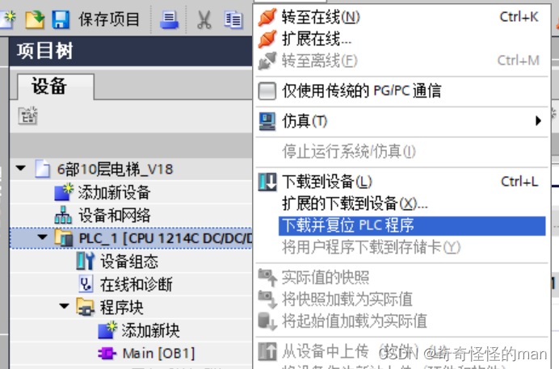

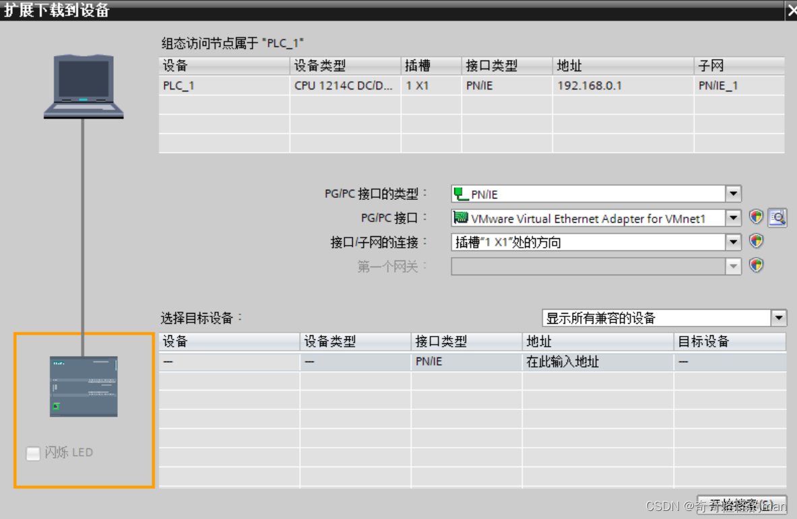

> **注意**：
> - 如果使用的是 **EET**（单部电梯仿真文件），选择以上图的 PG/PC 接口即可。
> - 如果使用的是 **EET Pro**（带加密狗的硬件平台），则应选择自己电脑与下位机连接的 USB/网卡接口。

点击**开始搜索**，然后点击停止 PLC，再启动刚拷入的程序。至此软件连接部分完成。

### 常见问题：WinCC 无法读取 PLC 运行数据的解决方法

1. 打开电脑的**控制面板**，将右上方“查看方式”切换为**小图标**。
2. 点击 **设置 PG/PC 接口（32 位）**：

   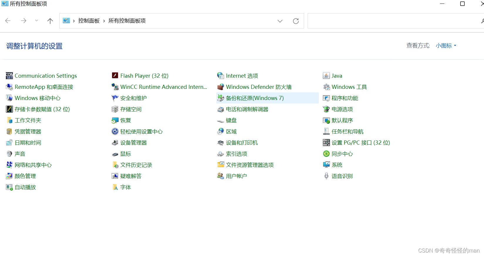

3. 应用程序访问点选择关联 WinCC（`S7ONLINE (STEP 7)`）：

   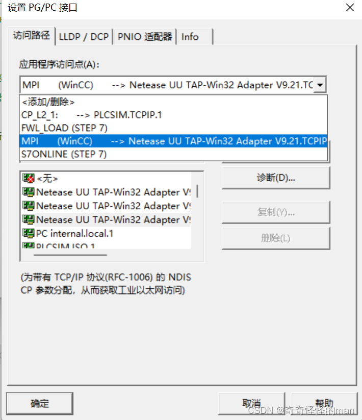

4. 最后选择与下位机相同网卡接口的 `.Auto` 后缀节点，点击确定即可连接。

---

## 三、程序框架讲解

信号的传输与接收是 PLC 程序设计的灵魂。我们新建**输入 DB 块**与**输出 DB 块**，将赛事方所给的变量添加其中，保证每个变量的**偏移量（Offset）**都与赛事方提供的 Excel 地址表完全一致：

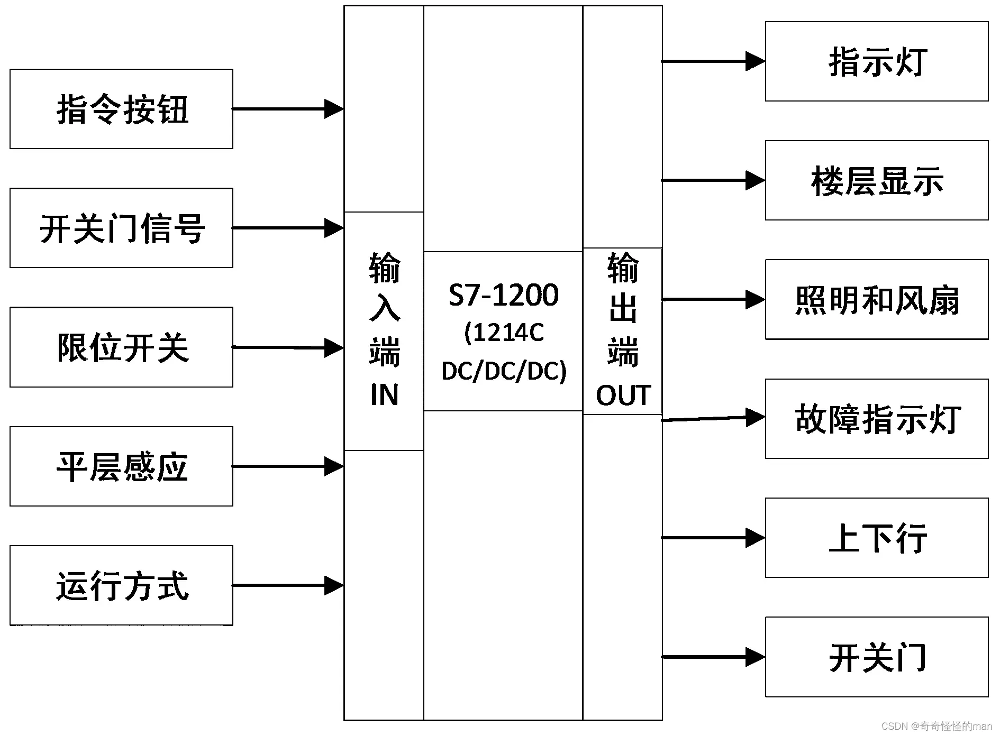

核心编程准则：

1. **运行条件**：电梯若想要运行，必须保证**上下行接触器信号**置 `1`（互锁）、**电机启动信号**置 `1`、**高低速接触器信号**置 `1`（互锁）。
2. **起保停原则**：在梯形图程序设计中，每一个模块都要遵从**起（启动）、保（保持/保护）、停（停止）**原则。规划变量使用时务必细心，保证每个变量被合法调用，否则会出现程序死机。
3. **检修安全**：电梯一旦出现检修信号，必须保证电梯停止运行，第 1 条中所有驱动变量复位，并且故障指示灯亮起。

---

## 四、浅谈对程序块的看法

### 1. OB 块（组织块）

学习过 C 语言的同学对函数的调用与被调用都有一定认识，梯形图的编写也遵从同样的思路：当程序开始运行后，就像从 C 语言的 `main` 函数第一条语句开始执行一样，对应到梯形图中就是 **OB1 主循环组织块**。

以下是博途自带的关于 OB 块的解释与不同 OB 块的使用规则：

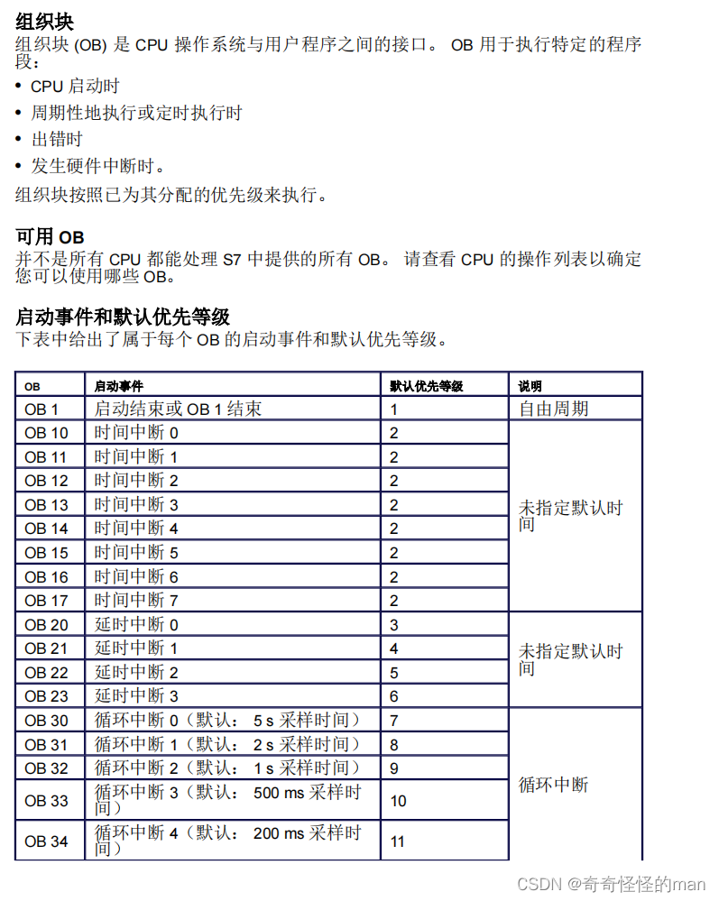

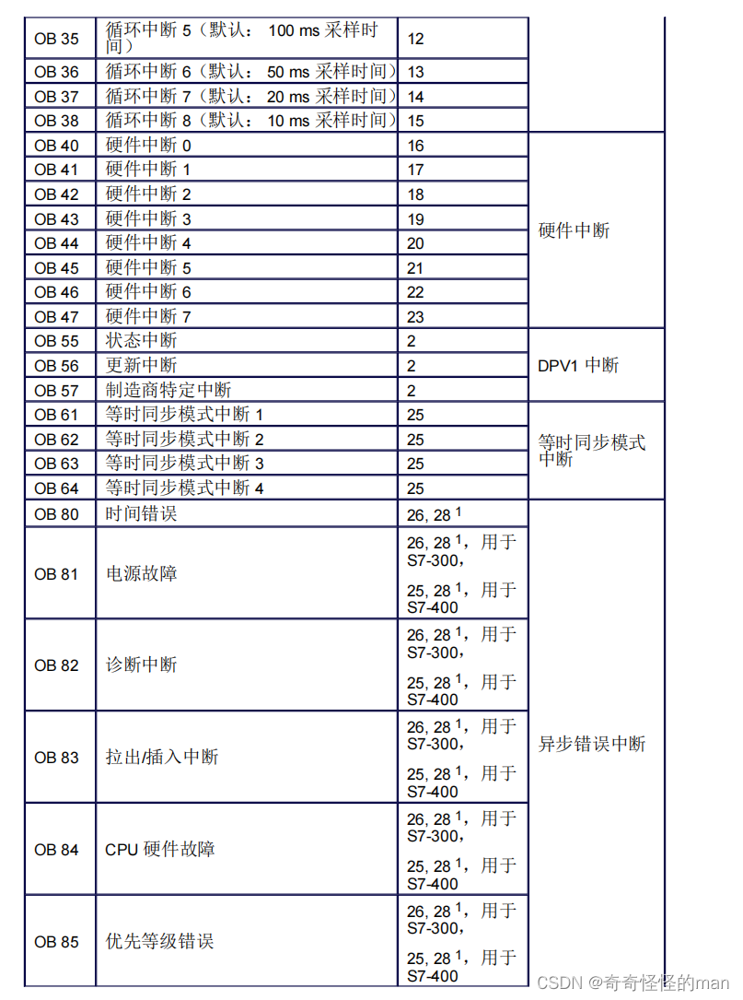

### 2. FC 块与 FB 块

FC 块与 FB 块中存放的是核心控制逻辑。在编写单部电梯时，只使用 FC 块就足够了；但在六部十层电梯系统中，每部电梯结构完全相同，就**必须使用 FB 块（带背景数据块的函数块）编写单梯逻辑，最后在 FC 块中集中调用**，否则会出现 PLC 工作存储器过载。

以下是查看程序运行内存占用的方法：

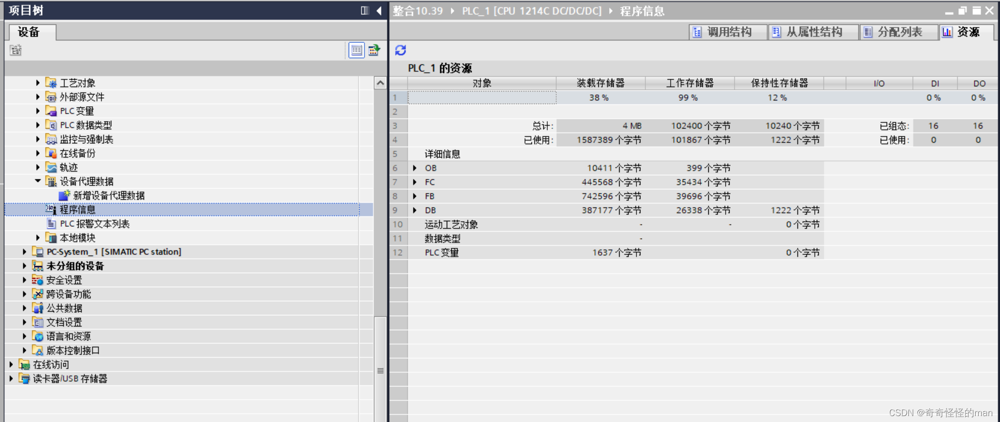

### 3. DB 块（数据块）

每个 DB 块就相当于一个抽屉，当我们在程序中调用变量时，就从抽屉中拿出这个变量来进行**写入**和**只读**操作。

由于六部十层电梯变量众多，为了方便管理变量，推荐采用**分组分类管理**：将最重要的输入输出变量放在主程序块组中，每部电梯各自的变量独立成组，将延时定时器背景变量（几乎每个变量只调用一次）统一归类在系统块中：

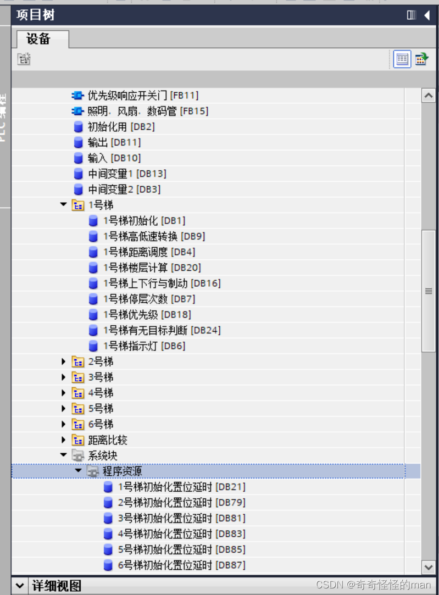

---

## 五、博途（TIA Portal）使用问题求助渠道

在使用博途 Portal 软件遇到任何问题时，推荐两个解决途径：
1. 访问“西门子杯”官方论坛：`http://bbs.siemenscup-cimc.org.cn/`
2. 按 `F1` 打开博途自带的帮助文档，输入指令或词条即可检索官方详细说明。

> 如有问题或建议，欢迎在本仓库提交 [Issue](../../issues) 交流。

---

[返回项目主页](../README.md) | [下一篇：初始化 →](02-initialization.md)
