# 第 2 篇：初始化

> 原文发表于 2024-05-15，迁移至 GitHub 时进行了排版整理与附图本地化。

电梯**初始化**分为两种情况：**无检修信号正常初始化**、**有检修信号特殊初始化**。

---

## 一、无检修信号正常初始化

比赛工程文件会在程序点击自动运行按钮之后，指定哪几部电梯能够正常运行。例如 3、4、5 号电梯处于检修状态，则只需要对 1、2、6 号电梯执行初始化。

初始化整体思维导图如下：

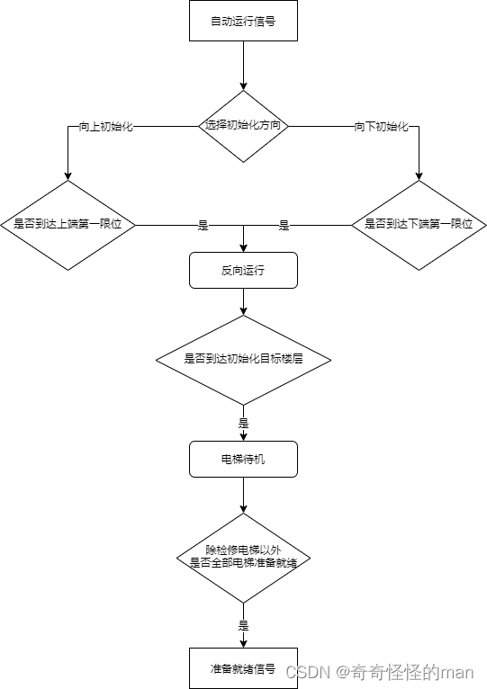

### 1. 设定初始化的三个参数

在设计程序中，我们最先需要设定初始化的三个参数：
1. **电梯的初始化楼层**（电梯从哪一层出发）
2. **初始化方向**（比赛中会有明确要求）
3. **电梯载重最大值**

因为这三个参数由赛题现场给定，所以在拿到赛题后需要第一时间进行修正。下面以图 1.1.1 ~ 图 1.1.5 举例说明相关程序代码块：

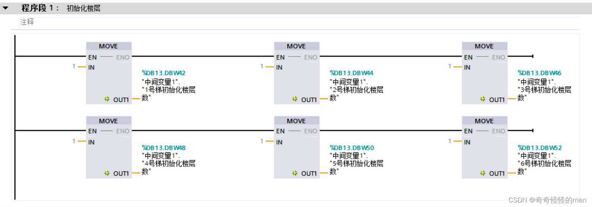
*图 1.1.1 初始化楼层数*

**图 1.1.1 梯形图分析**：使用 `MOVE` 模块便于现场快速修改楼层数，它将 `IN` 输入端操作数中的内容传送给 `OUT` 输出端操作数，但 `IN` 和 `OUT` 处的操作数必须为**相同的数据类型**。

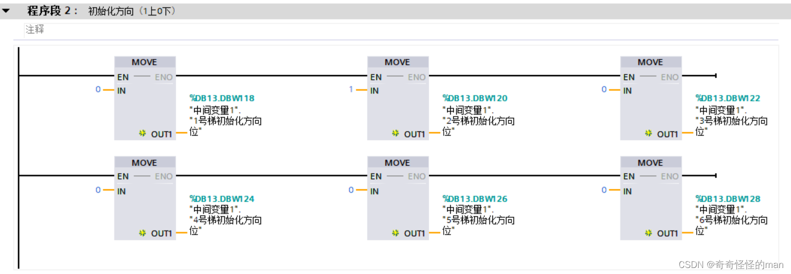
*图 1.1.2 初始化方向设定*

**图 1.1.2 梯形图分析**：`IN` 中输入的初始化方向实际上是布尔值（`0` / `1`），同样是为了方便比赛时快速配置，不用再手动调整位逻辑运算符，只需由程序自身判断电梯初始运行方向（初始化置位延时可以根据自身需要调整时间，防止程序死机）。

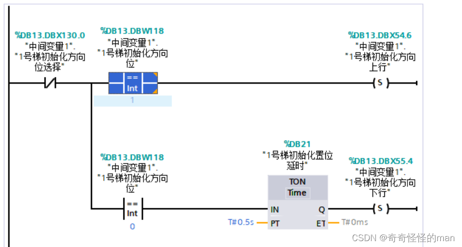
*图 1.1.3 运行方向判断*

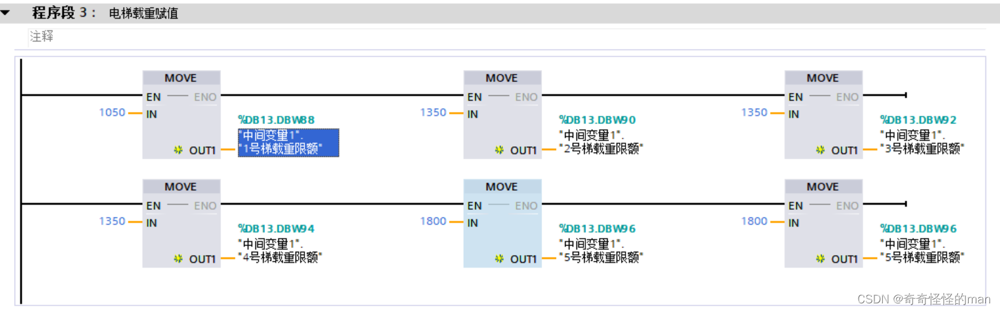
*图 1.1.4 最大载重量赋值*

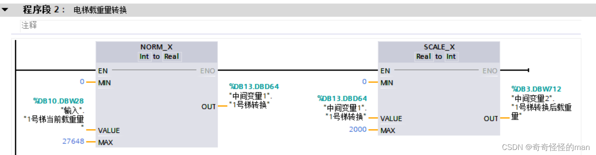
*图 1.1.5 载重量转换*

**图 1.1.4 / 图 1.1.5 梯形图分析**：在使用载重量进行 `Int` 型变量对比时一定要注意数据类型。如图 1.1.5 所示，比赛输入 DB 块给出的当前电梯重量为 `Word` 型变量，我们可以通过 `NORM_X` 和 `SCALE_X` 两个指令将 `Word` 型变量转换成 `Int` 型变量，再在系统中使用。

### 2. 是否到达第一限位和目标楼层判断

判断是否到达第一限位，作用是**反转运行方向**和**标定当前楼层基准**。

> **注意！一定不能接触第二限位（极限限位），碰一次就扣分！**

由于我们在赋值阶段就已经确定了初始运行方向，因此通过以下代码块判断是否到达第一限位（如图 1.2.1）：

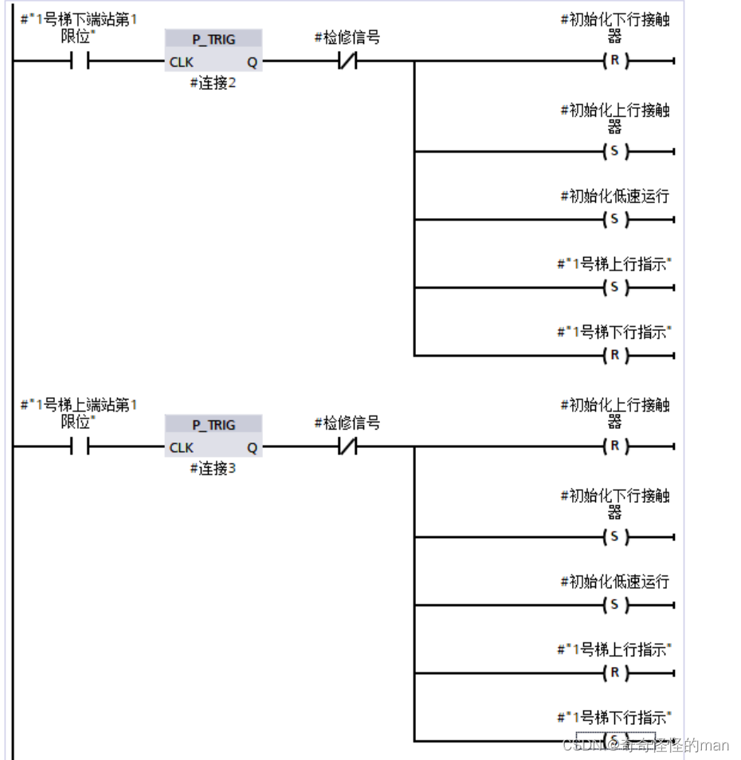
*图 1.2.1 到达第一限位后换向*

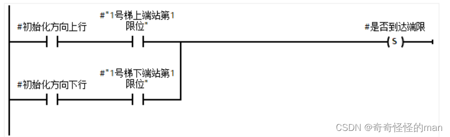
*图 1.2.2 判断是否到达顶端/底端限位*

**图 1.2.1 / 图 1.2.2 梯形图分析**：
- 本系统为了防止停靠楼层不稳，规定在距离停靠楼层上下一层时就将高速接触器切换为低速接触器，并且在到达端限后也切换为低速接触器。
- `P_TRIG` 指令块在每次执行时都会查询信号上升沿：检测到信号上升沿时，输出 `Q` 立即返回持续一个扫描周期的信号状态 `"1"`；在其他任何情况下输出均为 `"0"`。（注意：边沿存储器位的地址在程序中最多只能使用一次，否则会覆盖该位存储器，影响边沿评估导致结果不明确；边沿存储位必须位于 DB 块或 FB 静态区域/位存储区中。）

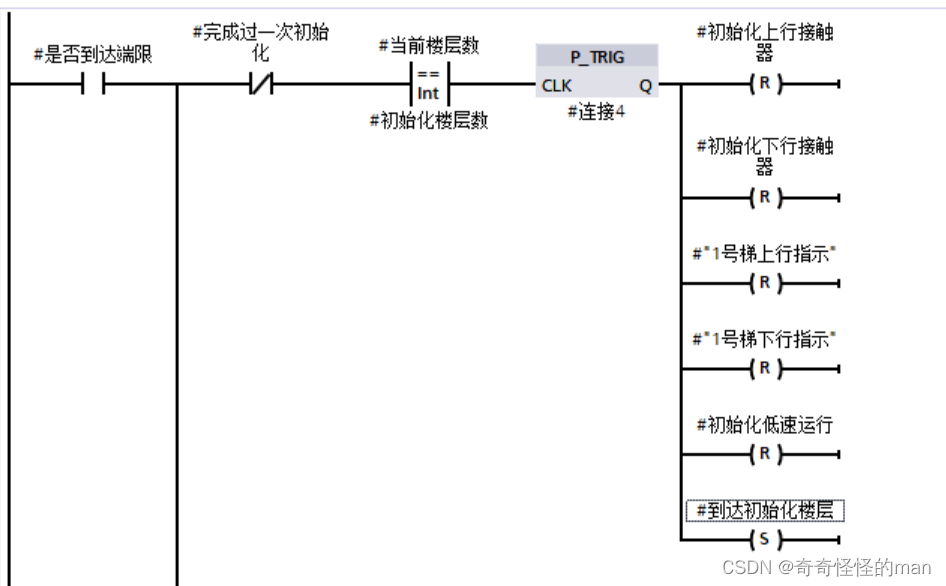
*图 1.2.3 单部电梯初始化完成，输出 DB 块 `#到达初始化楼层` 置 1*

> **注意**：在到达下端限和上端限后，楼层分别设定为 `0` 层和 `11` 层（方便后续统一进行加减楼层计算），具体原理见下一篇[楼层计算](03-floor-calculation.md)。

---

## 二、有检修信号特殊初始化

由于检修信号由比赛评测软件根据赛题注入，可能出现在**初始化前或运行过程中检修**，也可能出现**检修完成后此部电梯再次进行初始化**，因此分两种情况讨论：

### a）初始化前或运行过程中检修

当输入 DB 块中某部电梯的检修信号置 `1` 时，该部电梯不进行初始化，检修指示灯亮起。本系统规定当有检修信号时，该部电梯立即完全停止。

如果后续比赛要求出现检修信号时在**临近楼层就近停靠**，可以按以下逻辑实现：
1. 当检修信号置 `1` 时：高速信号置 `0`，低速信号置 `1`；
2. 当上下平层信号同时为 `1` 时：电机置 `0`，低速信号置 `0`，光幕/开门信号置 `1`，`群控分离` 信号置 `1`。

### b）检修完成此部电梯再次进行初始化（二次初始化）

因为在程序运行过程中某部电梯可能解除检修恢复投运，此时需要**只针对这一部电梯**单独执行二次初始化，如图 2.1.1 所示：

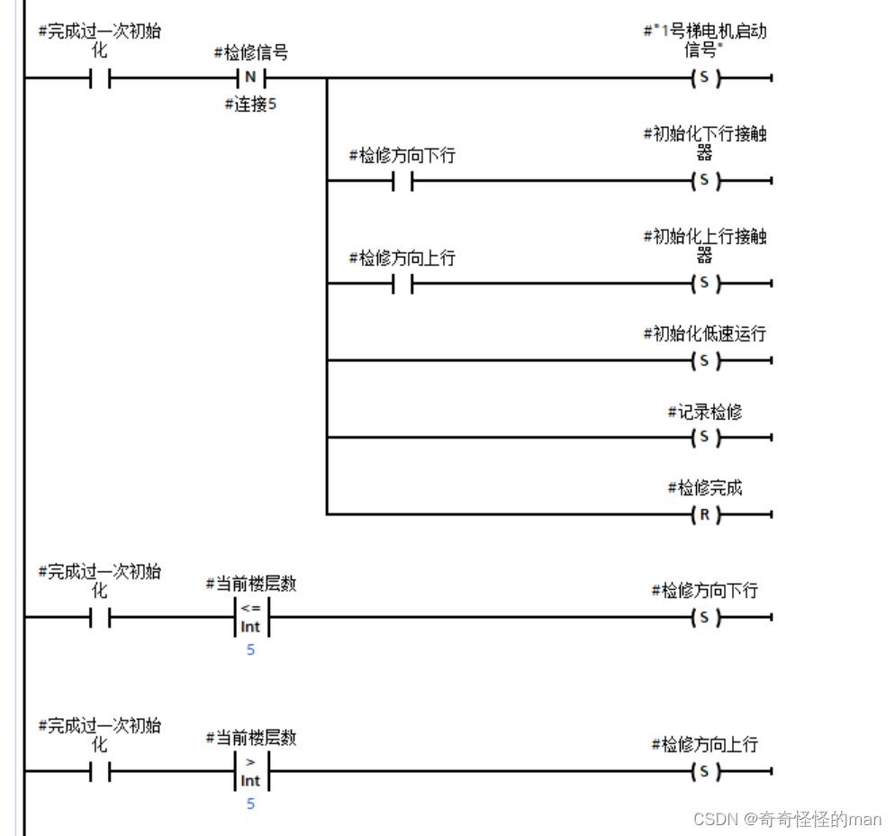
*图 2.1.1 二次初始化*

**图 2.1.1 代码块分析**：
- 通过 `|N|` 下降沿逻辑符（检修信号由 `1` 变 `0`）启动二次初始化，避免重复触发对单部电梯多次初始化导致死机。
- 二次初始化没有赛题强制的上下方向限制，自然越快到达端限越好：因此规定 **5 层及以下向下寻端限初始化，6 层及以上向上寻端限初始化**。
- 到达端限后，程序逻辑与正常初始化相同，完成反转方向与楼层标定，随后将 `群控分离` 置 `0`，使其重新接入群控系统接收外呼信号。

---

## 三、输出准备就绪信号

最后，在全部正常电梯初始化完成后，如图 3.1 所示输出系统准备就绪信号：

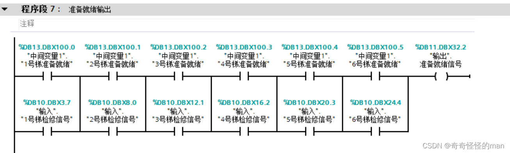
*图 3.1 输出准备就绪信号*

在实际编写中合理运用 FB 块和 FC 块，能使代码运行效率、可读性以及赛场改写速度大大提高。

> 如有问题或建议，欢迎在本仓库提交 [Issue](../../issues) 交流。

---

[← 上一篇：赛题分析与程序准备](01-competition-analysis-and-setup.md) | [返回项目主页](../README.md) | [下一篇：楼层计算 →](03-floor-calculation.md)
