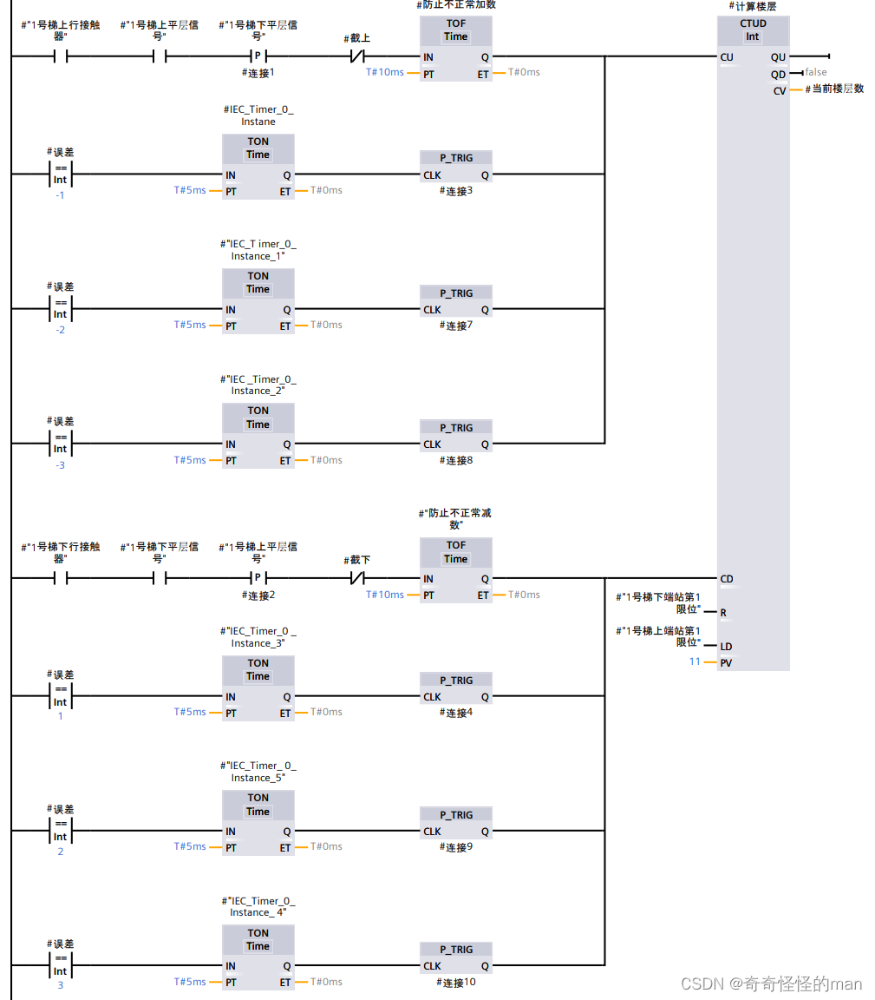
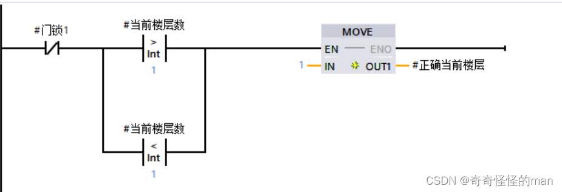
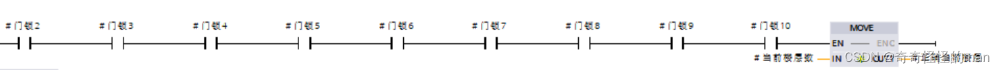
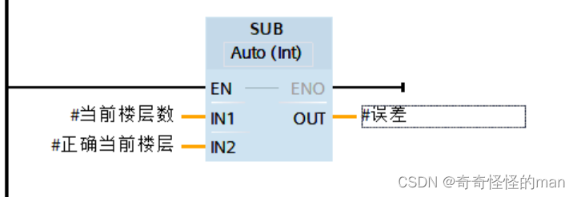
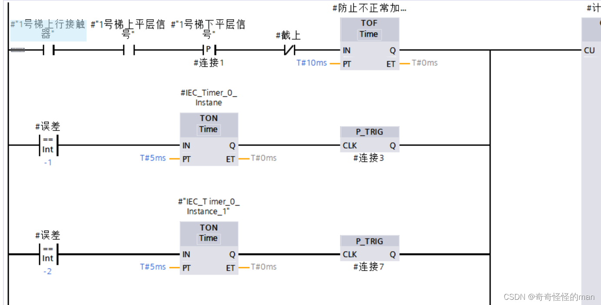
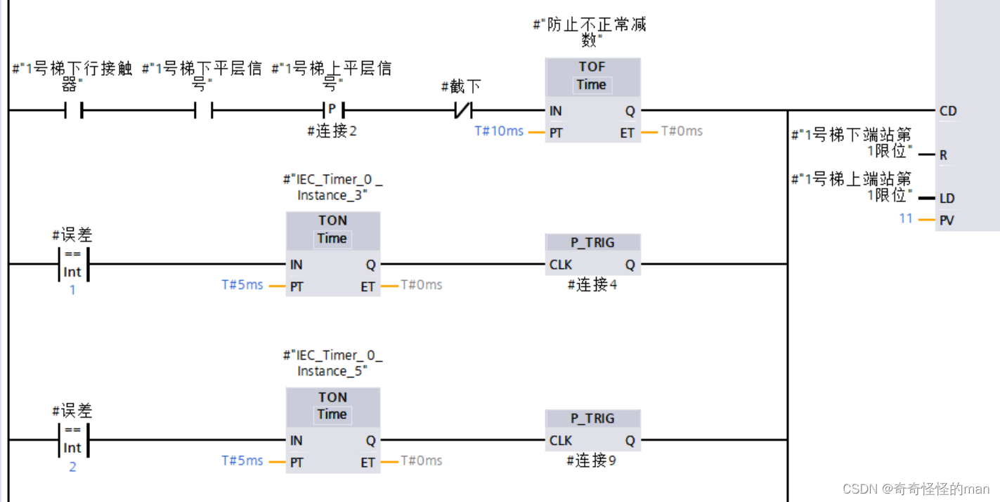
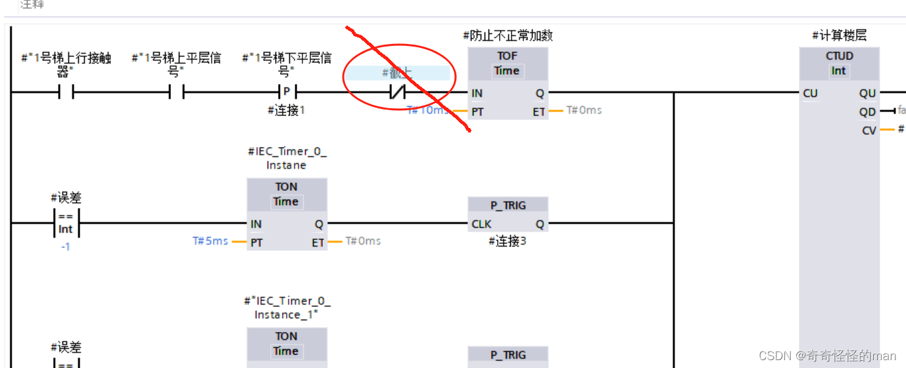
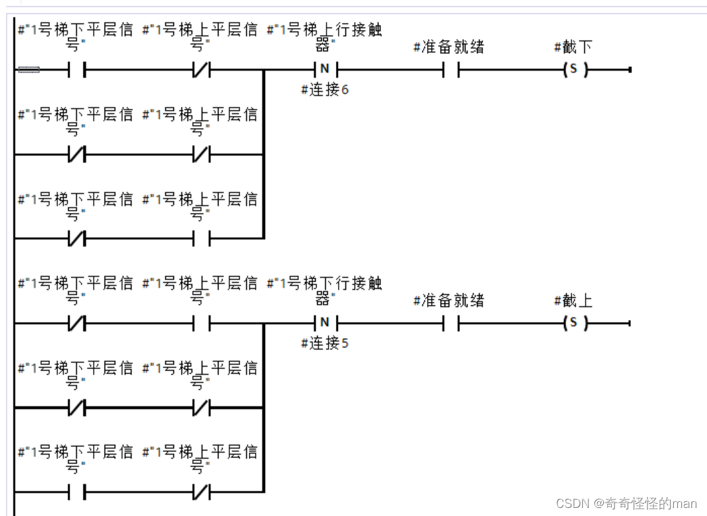
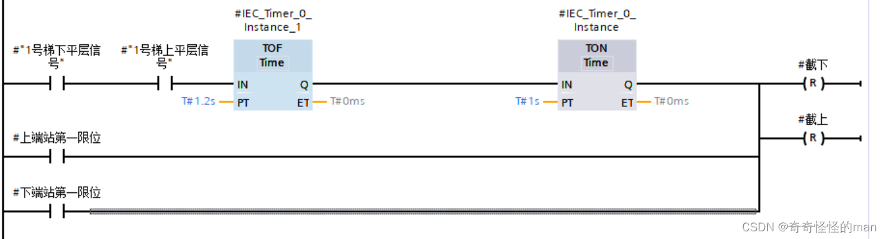

# 第 3 篇：楼层计算

> 原文发表于 2024-05-23，迁移至 GitHub 时进行了排版整理与附图本地化。

我们在思考电梯楼层计数时，自然会想到“上加下减”的方法，但如何稳定实现这一算法，保证不会出现计数紊乱、能够准确地被后续群控距离调度所调用，是值得仔细打磨并不断优化的。本文分享一套精简且带自校准机制的楼层计算方案。

---

## 一、基于端限与 CTUD 的基础楼层计数

电梯在到达上下端限后开始计数，具体梯形图如图 1.1 所示：

*图 1.1 楼层计数梯形图*

在图 1.1 中使用 `CTUD`（加减计数器）指令，递增和递减输出 `CV` 的计数器值。

> **`CTUD`（加减计数）指令功能说明**：
> 1. 如果输入 `CU` 的信号状态从 `"0"` 变为 `"1"`（信号上升沿），则当前计数器值加 1 并存储在输出 `CV` 中。
> 2. 如果输入 `CD` 的信号状态从 `"0"` 变为 `"1"`（信号上升沿），则输出 `CV` 的计数器值减 1。
> 3. 如果在一个程序周期内，输入 `CU` 和 `CD` 都出现信号上升沿，则输出 `CV` 的当前计数器值保持不变。
> 4. 计数器值可以一直递增，直到达到输出 `CV` 指定数据类型的上限；达到上限后，即使出现上升沿也不再递增。达到下限后同理不再递减。
> 5. 输入 `LD` 的信号状态变为 `"1"` 时，将输出 `CV` 的计数器值预设为参数 `PV` 的值；只要 `LD` 仍为 `"1"`，输入 `CU` 和 `CD` 的状态变化不会影响指令。
> 6. 当输入 `R` 的信号状态变为 `"1"` 时，将计数器值复位为 `"0"`；只要 `R` 仍为 `"1"`，输入 `CU`、`CD` 和 `LD` 的状态改变均不会影响计数器。
> 7. 如果当前计数器值大于或等于参数 `PV` 的值，则输出 `QU` 置位为 `"1"`，否则为 `"0"`。
> 8. 如果当前计数器值小于或等于 `"0"`，则输出 `QD` 置位为 `"1"`，否则为 `"0"`。

简单来说，就是 `CTUD` 中 `CU`（Count Up）触发 `+1`，`CD`（Count Down）触发 `-1`，到达下限位和上限位时分别置为 `0` 和 `11`，由 `CV` 输出当前楼层。

---

## 二、基于门锁信号的楼层误差校准

以上是通过上下限位与平层信号模拟出的电梯楼层，但工程代码往往是“一行能运行，十行做维护”。下面介绍电梯楼层计数的**误差自校准方法**——利用**门锁信号**（赛题输入 DB 块提供）来校验电梯真实物理位置：

*图 1.2 门锁判断楼层（例）*

**图 1.2 梯形图分析**：
- 当某层门锁信号置 `1` 时说明该层电梯门处于关闭状态；当某层门锁信号置 `0`（开门）时，将 `IN` 对应的楼层号传送到 `OUT` 中，设定为`当前正确楼层数`。
- 当十层电梯的门锁信号全部置 `1`（所有门关闭）时，设定 `当前正确楼层 = 当前楼层`（防止多次写入或误触发导致异常）。

*图 1.3 假设出现误差信号时的修正逻辑*

**图 1.3 梯形图分析**：如果 `当前楼层数 - 正确楼层数` 出现差值，则反馈回计数器函数进行补偿调整——出现正差值则减 1，出现负差值则加 1，实时修正结果，保证后续电梯群控调配算法不会因楼层漂移而出错。

---

## 三、`#截上` 与 `#截下` 防误计锁存变量

细心的读者会发现在程序中出现了 `#截上`、`#截下` 两个变量，下面讲解它们的具体作用。

如果没有 `#截上`、`#截下` 这两个互锁变量（如图 1.4 所示），电梯在运行过程中经过上下平层传感器重叠区时，可能不分上升还是下降都重复触发计数，导致楼层错乱。引入这两个变量后，就相当于**在电梯上行接触器置 `1` 时挂一把锁，禁止楼层出现减法计数；下行时反之同理**。

*图 1.4 分析示意图*

*图 1.5 截上截下梯形图*

**图 1.5 梯形图分析**：
- 电梯上下平层的三种传感器组合情况都要考虑在内，并且上下行接触器使用**下降沿触发**（例如当下行接触器的下降沿触发时，说明电梯刚进入停止状态或切换状态，防止惯性滑行期间不正常加减楼层），保证这两个变量不会在正常运动中错误保持。
- 当电梯到达上下端限位后，将 `#截上`、`#截下` 变量释放复位，使计数器能够重新恢复到 `0` / `11` 层基准位置重新开始计数。

本节逻辑并不复杂，核心在于**对“当前楼层”这一核心状态变量的冗余维护**——因为后续全部群控分配算法的基础就是楼层数据的绝对准确。

> 如有问题或建议，欢迎在本仓库提交 [Issue](../../issues) 交流。

---

[← 上一篇：初始化](02-initialization.md) | [返回项目主页](../README.md) | [下一篇：信号显示 →](04-signal-display.md)
