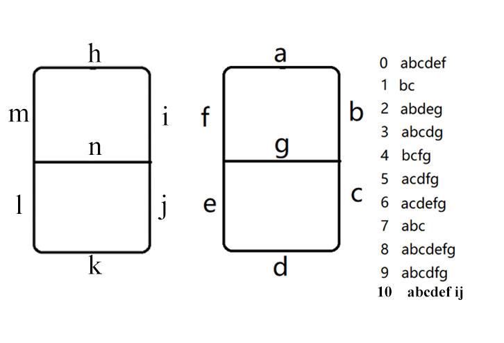
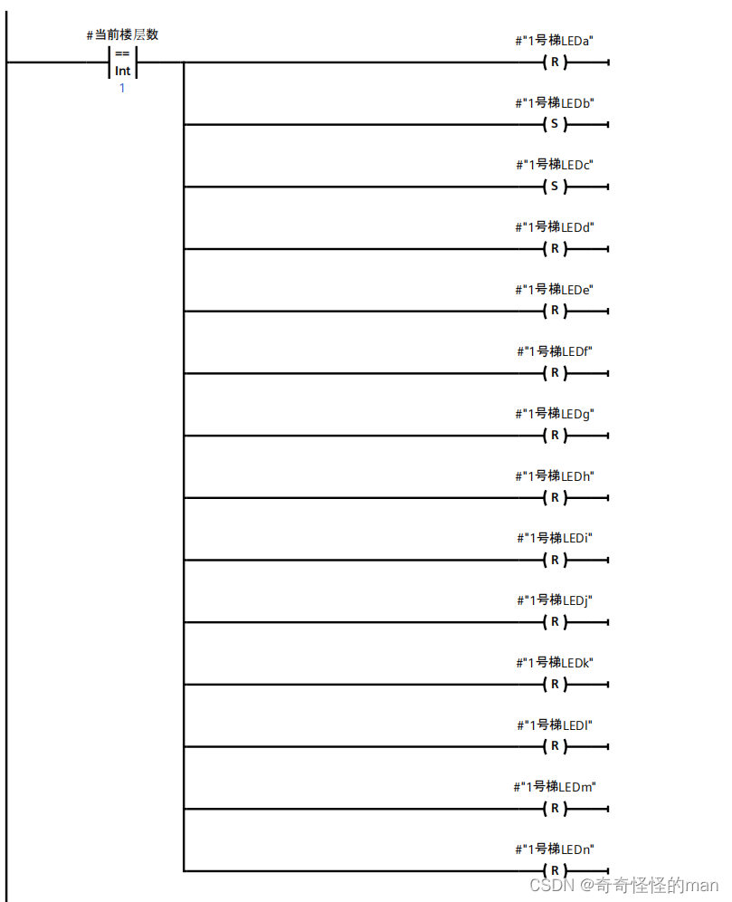
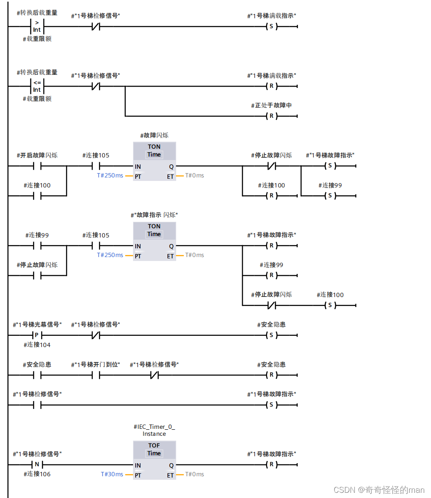
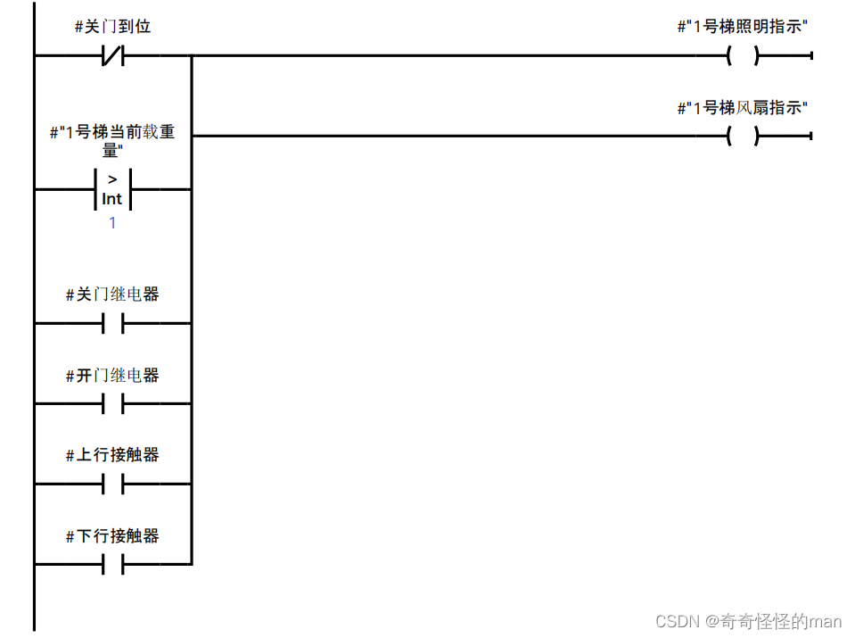

# 第 4 篇：信号显示

> 原文发表于 2023-07-30，迁移至 GitHub 时进行了排版整理与附图本地化。

本篇文章介绍六部十层电梯系统中各类指示灯、数码管及轿厢照明/风扇的编写要求。在编写大型 PLC 程序时，我习惯采用“从简到难、围点打援”的策略——先从[初始化](02-initialization.md)和状态显示灯信号入手，快速跑通输入输出链路，下面正式开始。

---

## 一、数码管楼层显示

在六部十层电梯模型中，轿厢楼层数码管使用 `a` ~ `n` 共 **14 段信号**分别控制单段笔画的亮灭：

下图展示当数码管显示楼层数字 `1` 时的梯形图代码，其余数字 `2` ~ `10` 以此类推：

---

## 二、故障与满载显示

1. 本次初赛赛题明确要求：**当电梯处于满载状态时，故障指示灯不能亮起**。
2. 当单部电梯输入**检修信号**后，故障指示灯亮起，该梯所有运行信号切断，并执行**群控分离**。

程序部分代码如下（检修状态下其他信号的复位逻辑见[初始化篇](02-initialization.md)与[电梯上下行运动](05-up-down-motion.md)）：

---

## 三、轿厢照明与风扇显示

照明与风扇控制的核心逻辑只有两点：
1. **轿厢内有人时亮灯开风扇**（即使乘客在电梯内尚未按下内呼按钮）；
2. **在接客运行过程中亮灯开风扇**。

在关门完成后，若监测到电梯内无人，照明灯与风扇可以根据需要选择立即关闭或延时关闭。程序部分代码如下：

> 如有问题或建议，欢迎在本仓库提交 [Issue](../../issues) 交流。

---

[← 上一篇：楼层计算](03-floor-calculation.md) | [返回项目主页](../README.md) | [下一篇：电梯上下行运动 →](05-up-down-motion.md)
