# 第 5 篇：电梯上下行运动

> 原文发表于 2024-07-10，迁移至 GitHub 时进行了排版整理与附图本地化。
>
> **阅读说明**：文中 `代码格式` 表示程序变量名，**粗体**表示引用的 FC/FB 块，链接指向本系列相关章节。

电梯的运行状态直接由**上下行接触器**驱动与控制。

---

## 一、正常运行下各信号状态

### 1.1 上下行接触器

- 如图 1.1.1 所示，当初始化完成且 `准备就绪` 信号置位后，电梯开始根据 `上行指示` / `下行指示` 来控制 `上行接触器`（下行同理）；
- 如图 1.1.2 所示，初始化刚结束或电梯进入检修状态时，接触器必须执行复位；
- 如图 1.1.3 所示，电梯在未完成停梯截断（开关门流程未结束）时，接触器同样保持复位。

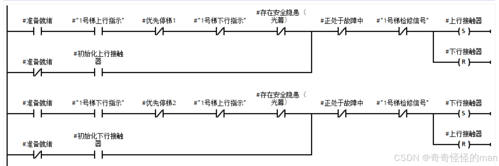
*图 1.1.1*

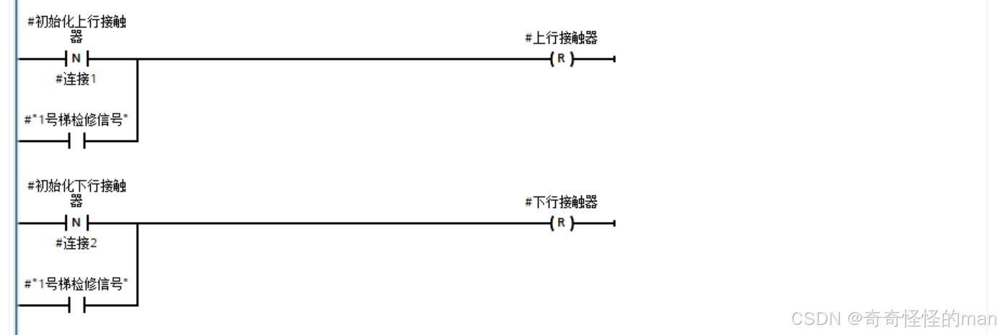
*图 1.1.2*

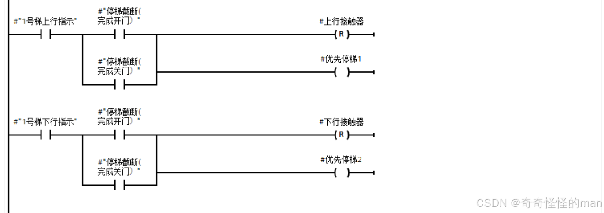
*图 1.1.3*

即使经过上图合理控制上下行接触器，在复杂工况下仍难免遇到接触器信号被短暂重置覆盖、导致电梯半途停梯卡住的情况。以下代码专门用于应对信号冲突时的**电梯卡顿恢复**：

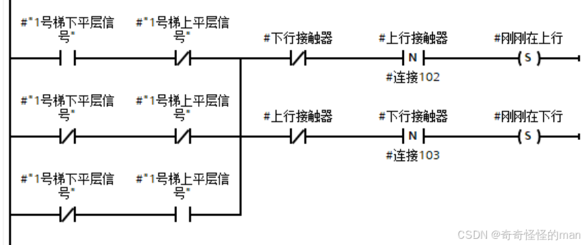

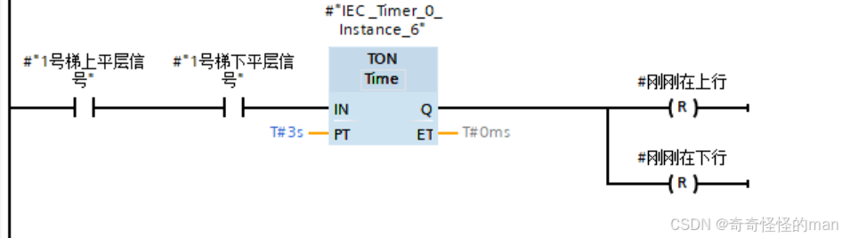
*图 1.1.4*

**图 1.1.4 梯形图分析**：本系统设置 `刚刚在上下行` 变量来存储上一阶段的运行状态（可以简单理解为帮助电梯“回忆刚刚在干啥”）。以第一行为例，每当 `上行接触器` 复位产生下降沿信号，且电梯尚未平层时，状态被 `刚刚在上行` 记录，随后在图 1.1.5 中用于恢复电梯运行状态；当电梯到达上下平层置位时，`刚刚在上下行` 复位清零。

> 注：`卡顿制速` 变量在下一篇[高低速转换与制动](06-speed-switching-and-braking.md)中读取，采用二级制动效果。

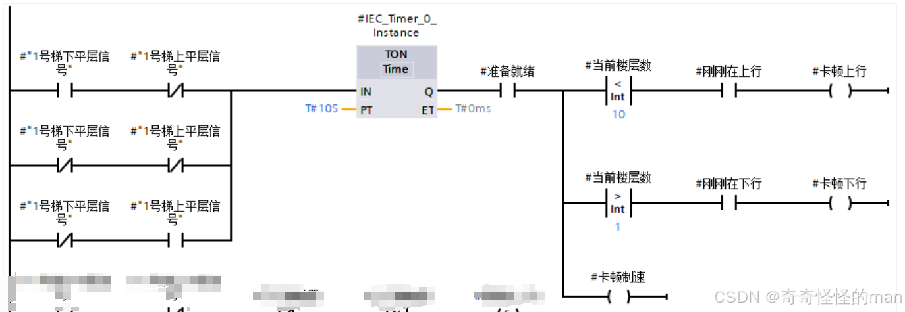
*图 1.1.5*

### 1.2 上下行指示

以 1 号梯上行指示为例：

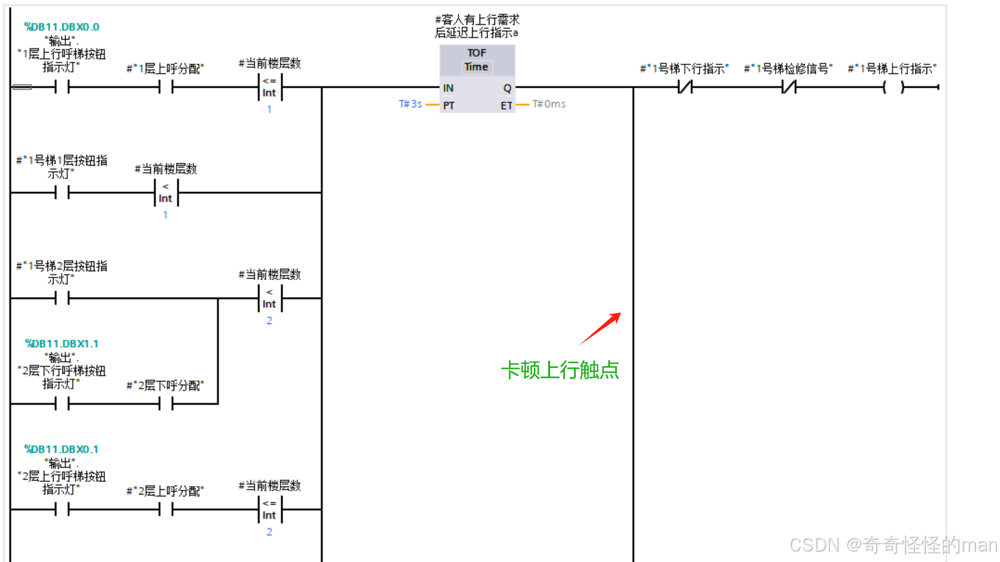
*图 1.2.1*

**图 1.2.1 梯形图分析**：当以下三种情况任意一种存在时，`1号梯上行指示` 置位：
1. 上呼信号分配给了 1 号梯，且当前电梯位置小于等于所分配的层数；
2. 电梯内的乘客按下了比当前电梯层数更高的内呼楼层；
3. 下呼信号分配给了 1 号梯，且电梯当前楼层小于被分配的下呼楼层（例如 2 层下呼指示灯亮并分配给在 1 层的电梯，且没有上述前两种情况时，电梯会先上行到 2 层接乘客）。

### 1.3 外呼指示灯和按钮

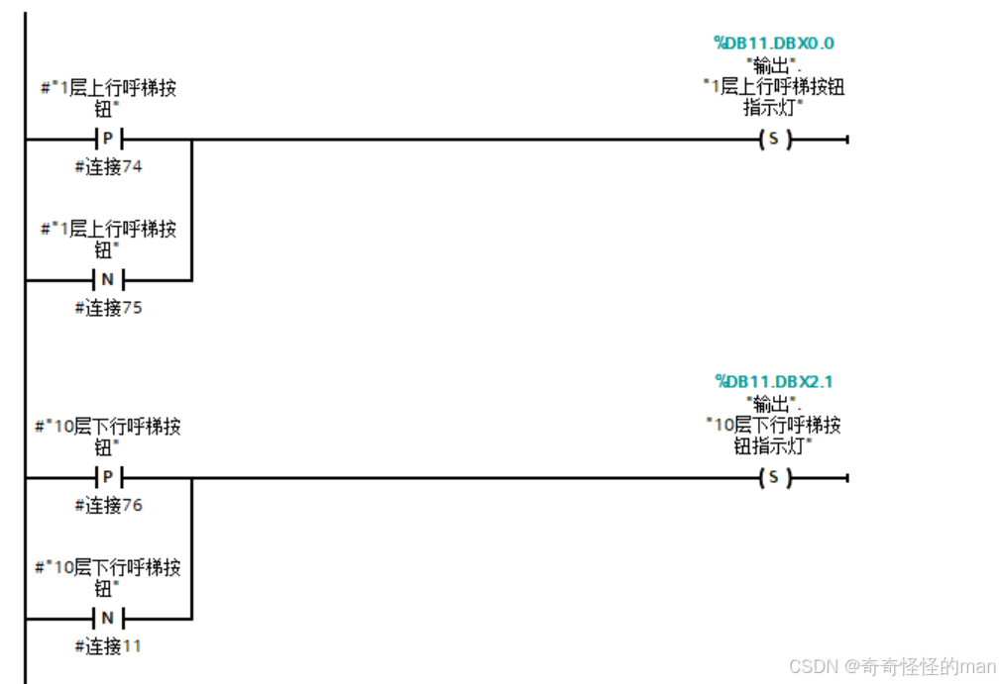
*图 1.3.1*

**图 1.3.1 梯形图分析**：逻辑很直观，按下按钮即点亮（置位）对应外呼指示灯，2 ~ 9 层同理。

### 1.4 内呼指示灯和按钮

以 1 层 / 2 层为例：

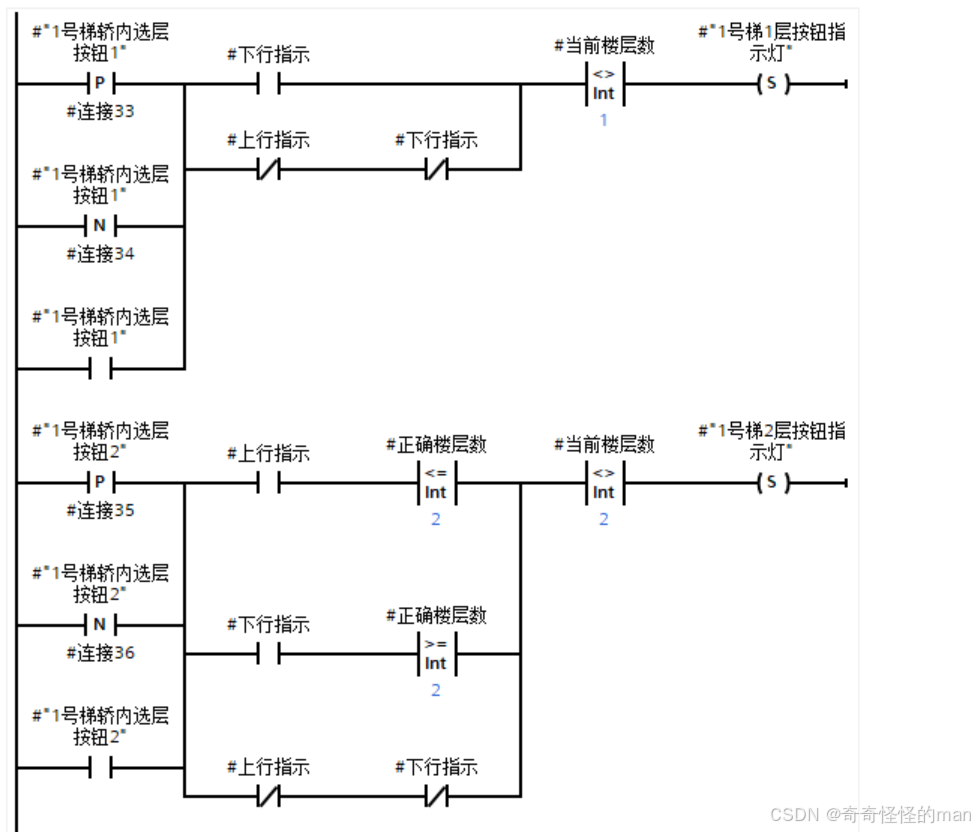
*图 1.4.1*

**图 1.4.1 梯形图分析**：当电梯正在上行时，不能使电梯当前层数以下的内呼指示灯置位（通俗地说，乘客坐反方向时，不能点亮与当前运行方向相反的内呼灯）。

---

## 二、其他辅助运行状态

### 2.1 判断就近运动的电梯

本节需配合[群控调度算法](09-dispatch-algorithm.md)中 **距离比较** FB 块的代码一并阅读：

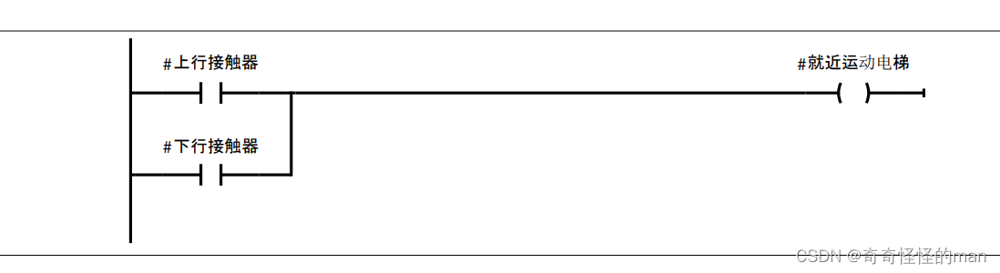
*图 2.1 判断其他在运行中的电梯*

### 2.2 判断是否满载

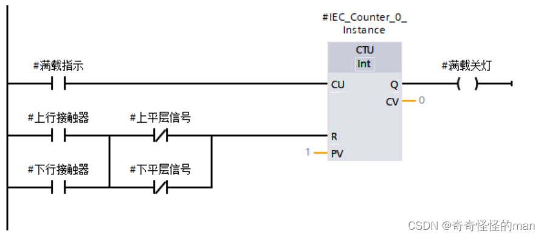
*图 2.2 电梯满载后关灯判断*

**图 2.2 梯形图分析**：本段代码对灭灯与重分配程序起辅助作用。假设 1 号电梯在上行过程中于 4 层达到满载，系统会将已分配给 1 号电梯的 4 层以上外呼信号释放并重新分配给其他电梯；1 号梯此后只响应轿厢内呼，直至满载状态解除复位。

### 2.3 判断“电梯内有人但不走”异常状态

电梯在运行过程中可能出现**轿厢内有乘客，但乘客未按内呼按钮，且外部也无外呼任务**的情况，此时进入如图 2.3 所示的异常处理梯形图：

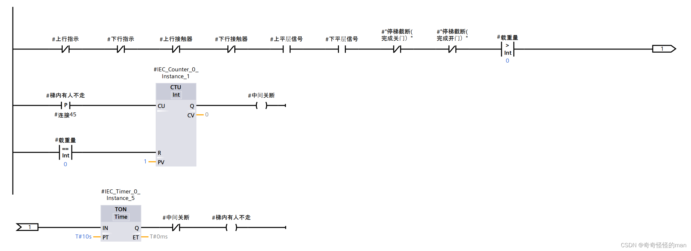
*图 2.3 判断电梯内有人不走状态*

**图 2.3 梯形图分析**：当载重量大于 `0`、电梯无运行方向、处于平层状态且持续满 `10s` 时，`电梯内有人但不走` 变量置位；触发其上升沿后计数器 `+1`，输出 `中间关断` 置位，切断当前僵持状态，强制使电梯释放并可响应下一次接客任务。

> 如有问题或建议，欢迎在本仓库提交 [Issue](../../issues) 交流。

---

[← 上一篇：信号显示](04-signal-display.md) | [返回项目主页](../README.md) | [下一篇：高低速转换与制动 →](06-speed-switching-and-braking.md)
