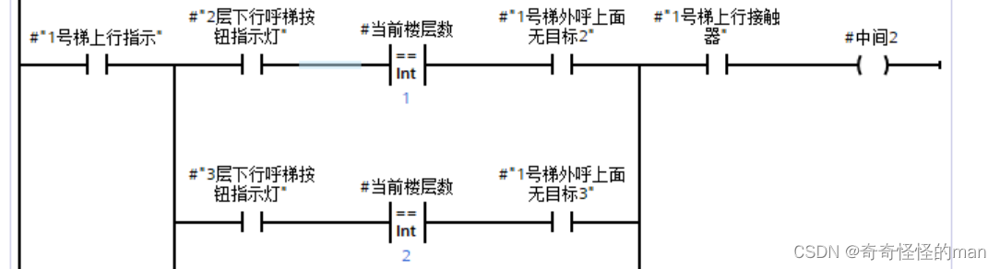
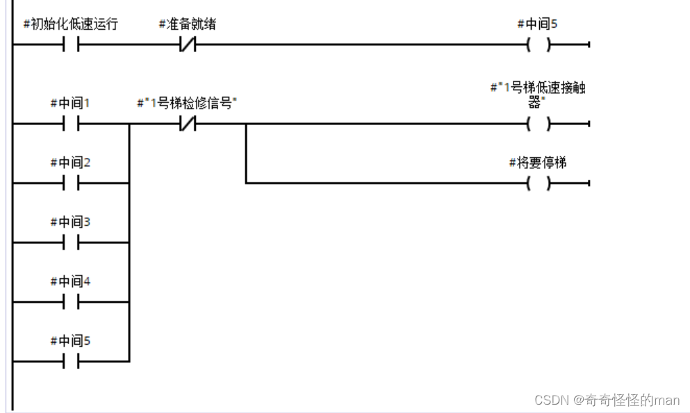
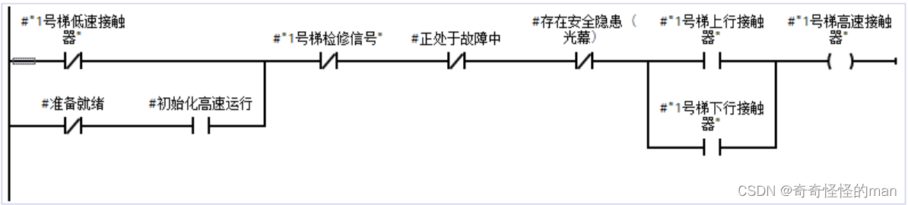
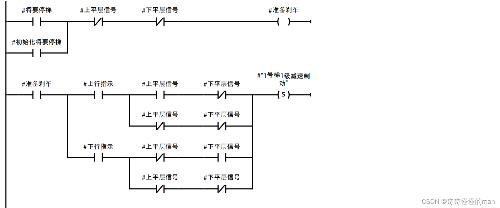
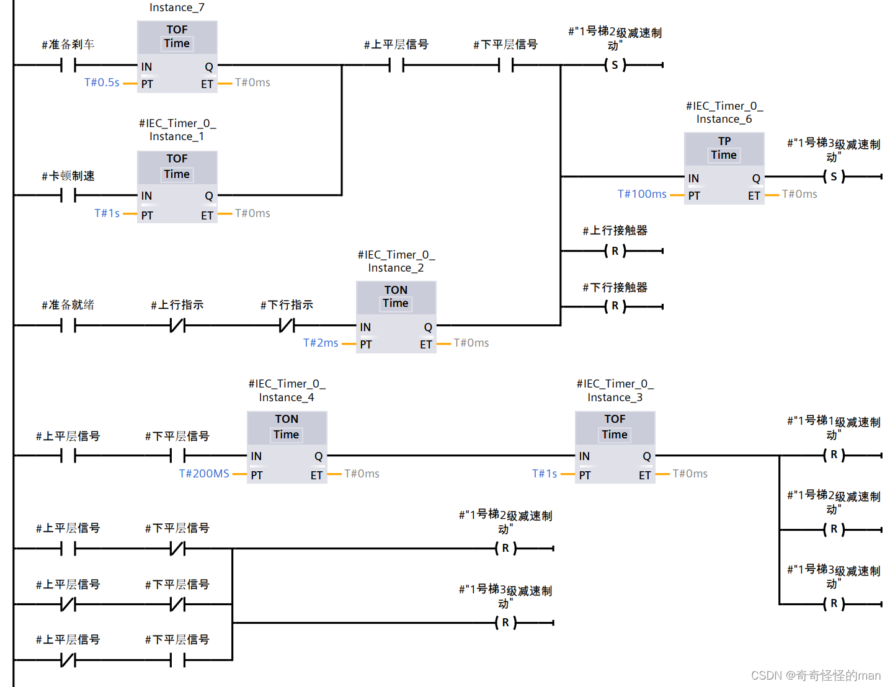

# 第 6 篇：高低速转换与制动

> 原文发表于 2024-05-28，迁移至 GitHub 时进行了排版整理与附图本地化。

电梯制动时间并不是越短越好，而是**在保证电梯平稳停靠的前提下越快越好**——因为一旦冲过平层或未停稳，就会导致上下平层信号未能同时置位，进而引发后续流程死机。

因此，本系统采用**三级制动**方案，并在目标停靠楼层**前一层**提前切换低速与启动制动，实测停靠稳定性非常可靠。下面对核心代码逐步分析。

---

## 一、高低速转换

高低速转换共分为 **5 小类工况**：
1. 电梯上行，响应下外呼/内呼停靠；
2. 电梯上行，响应上外呼/内呼停靠；
3. 电梯下行，响应下外呼/内呼停靠；
4. 电梯下行，响应上外呼/内呼停靠；
5. [初始化](02-initialization.md)过程中的低速寻端限与停靠。

下面以 **1 号梯向上运行、响应向下外呼停靠** 为例：

*图 1.1 高低速转换梯形图*

**图 1.1 梯形图分析**：当电梯在向上运行过程中，只有本层以上无其他外呼目标时，才会响应最远端反向外呼楼层的停靠；核心要点是在**目标停靠楼层前一层**开启高低速转换。图中 `中间2` 为中间传递信号，在图 1.2 中读取使用。

*图 1.2 低速转换*

**图 1.2 梯形图分析**：例如 1 号梯满足上述任一减速停靠工况时，低速接触器置位，同时 `将要停梯` 标志位置位（该变量在下方图 2.1 三级制动中使用）。

*图 1.3 高速转换*

**图 1.3 梯形图分析**：低速接触器与高速接触器必须构成**电气互锁**，两个变量严禁同时置位；当不存在上述 5 种减速情况时，电梯默认处于高速运行模式。

---

## 二、三级制动

*图 2.1 三级制动系统*

**图 2.1 梯形图分析**：当图 1.2 中 `将要停梯` 置位后，电梯已进入低速模式；随后按梯形图延时时序依次投入 `一级制动`、`二级制动`、`三级制动`。当准确到达上下平层位置（上下平层传感器同时为 `1`）后，`三级制动` 与 `上下行接触器` 同时复位，完成平稳停梯。

> **注意**：编写时需根据仿真模型惯性微调各级制动之间的延时参数；图中出现的 `卡顿制速` 变量详见上一篇[电梯上下行运动](05-up-down-motion.md)。

> 如有问题或建议，欢迎在本仓库提交 [Issue](../../issues) 交流。

---

[← 上一篇：电梯上下行运动](05-up-down-motion.md) | [返回项目主页](../README.md) | [下一篇：停梯优先级响应与开关电梯门 →](07-stop-priority-and-doors.md)
