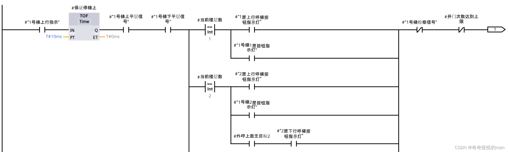
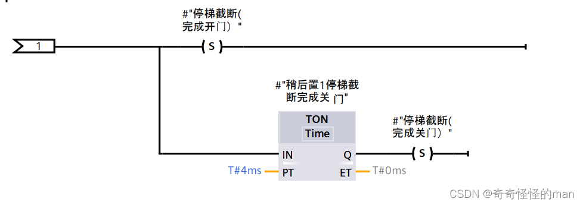
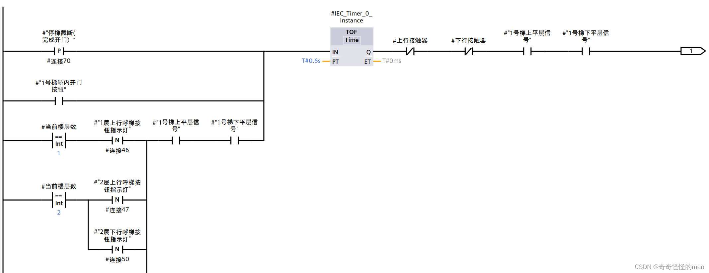
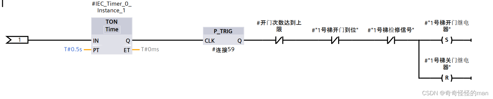
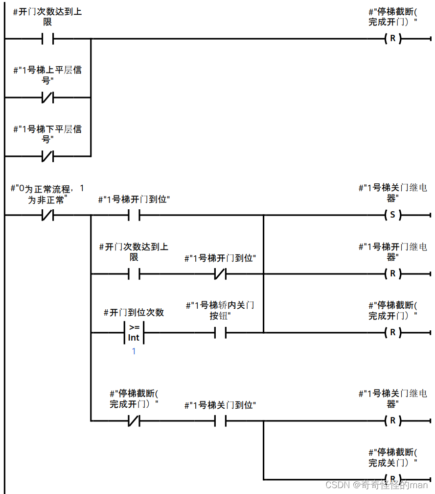
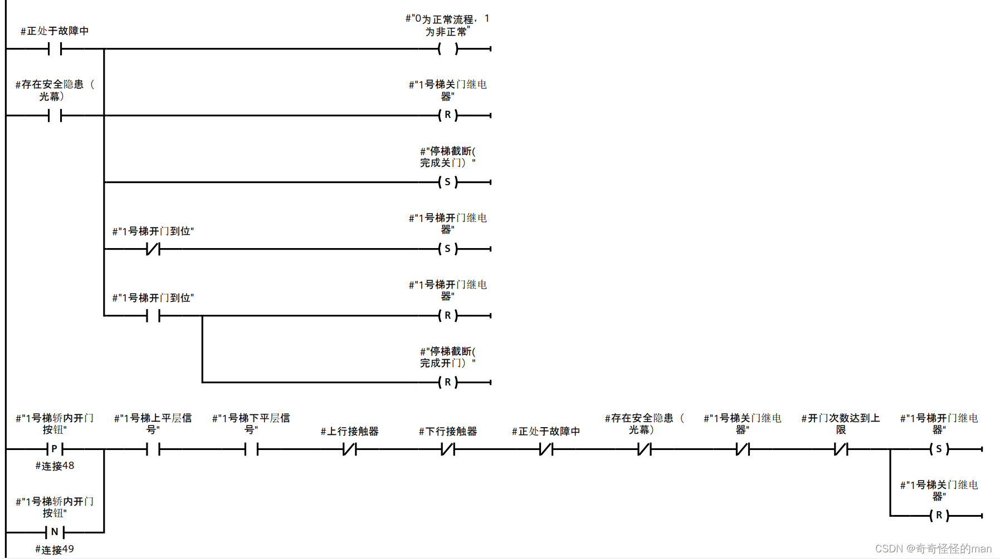
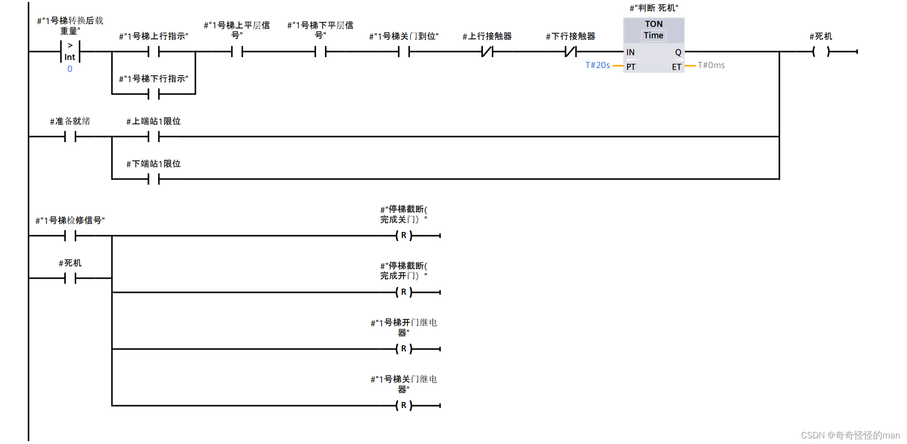
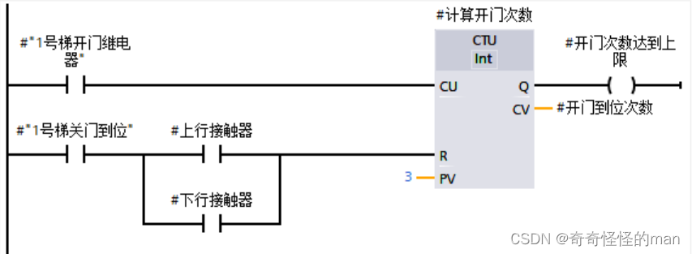
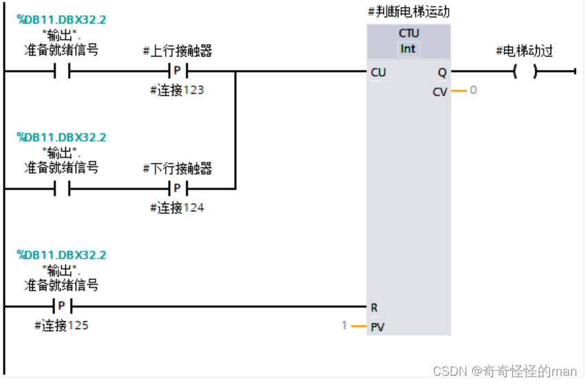

# 第 7 篇：停梯优先级响应与开关电梯门

> 原文发表于 2024-05-28，迁移至 GitHub 时进行了排版整理与附图本地化。

为了防止在电梯启动和停止控制中共用同一变量引发逻辑互锁死机，本系统采用**双变量分离控制**：
- 用“停梯优先级”模块中的 **`停梯截断`** 优先控制 **“停”**；
- 再用“开关门”模块中的 **`完成开门关门`** 严格控制 **“动”**。

此外，在电梯从停梯到重新启动的完整周期中依次经历三个阶段：**停梯** → **停梯后自主开门** → **停梯自主完成开门后关门**。

---

## 一、电梯停梯到启动过程

### 1. 停梯

以 1 号梯上行状态为例：

*图 1.1 上行停梯梯形图*

**图 1.1 梯形图分析**：当电梯处于上行状态，且上下平层传感器同时置 `1` 时，无论是本层上行外呼还是当前楼层轿厢内呼，都会触发电梯进入停梯状态。

> **变量注释**：
> - `停梯截断（完成开门）` —— 置 `0` 表示完成开门；
> - `停梯截断（完成关门）` —— 置 `0` 表示完成关门。

### 2. 停梯后自主开门

*图 1.2 停梯后开门梯形图*

**图 1.2 梯形图分析**：电梯进入开门状态共有 **三种触发前提**：
- **a）** `停梯截断` 置 `1` 后；
- **b）** 轿厢内部开门按钮置 `1` 后；
- **c）** 电梯停靠目标楼层、对应上下外呼指示灯复位后。

### 3. 停梯自主完成开门后关门

*图 1.3 停梯自主完成开门后关门梯形图*

**图 1.3 梯形图分析**：
- 当**开门次数到达限制**或 **`停梯截断（完成开门）` 置 `1`** 后，电梯进入关门状态；
- 关门过程中若出现**故障**、**光幕信号置 `1`** 或 **轿厢开门/内呼触发** 时，电梯门立即停止关门并重新打开；
- 当电梯关门到位结束后，必须将上述过程变量全部复位，以便下一个扫描周期与下一次停靠正常执行。

---

## 二、保护类信号设计

在 PLC 编程中遵守“起保停”原则是程序稳定运行的基础，其中最值得深入思考的是如何做好 **“保”（异常保护与防死机恢复）**。下面重点介绍三项保护逻辑：**检修与死机状态恢复**、**开关门次数限制**、**判断电梯在初始化后是否正常运行**。

### 1. 检修与死机状态恢复

检修与死机在程序运行层面属于同类异常停滞状态，可采用统一思路处理：

*图 2.1 检修与死机状态*

**图 2.1 梯形图分析**：当电梯处于正常运行模式且轿厢内部有乘客的状态下，若上下行接触器在 `20s` 内始终未置位，则判定该电梯进入**死机状态**（常见诱因是在“停梯 → 启动”衔接过程中个别标志位未能及时置位或复位，俗称“信号遗漏”）。触发超时看门狗后，系统自动将上一阶段的锁存信号复位清零，使其重新进入正常响应外呼、内呼或检修流程。

### 2. 开关门次数限制

电梯到站后如果不对反复开关门次数加以限制，一旦某层外呼信号因冲突持续置位，就会导致电梯在同一楼层无限循环开关门而变相死机。因此通过图 2.2 的梯形图对单次停靠的开关门次数进行限制：

*图 2.2 限制电梯开关门*

**图 2.2 梯形图分析**：每次开门到位时计数器 `+1`，累计开门达到 **3 次** 后触发上限并强制关门锁死本层重复开门；待关门完成、电梯重新启动运行后立即复位计数器。

### 3. 判断电梯在初始化后是否正常运行

*图 2.3 检测电梯是否正常运行*

> 如有问题或建议，欢迎在本仓库提交 [Issue](../../issues) 交流。

---

[← 上一篇：高低速转换与制动](06-speed-switching-and-braking.md) | [返回项目主页](../README.md) | [下一篇：停梯次数计算 →](08-stop-count.md)
