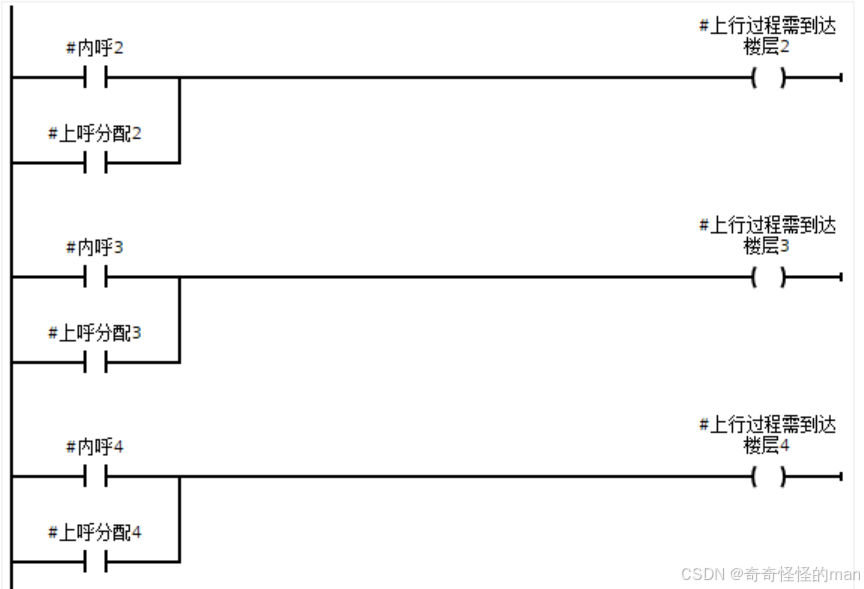
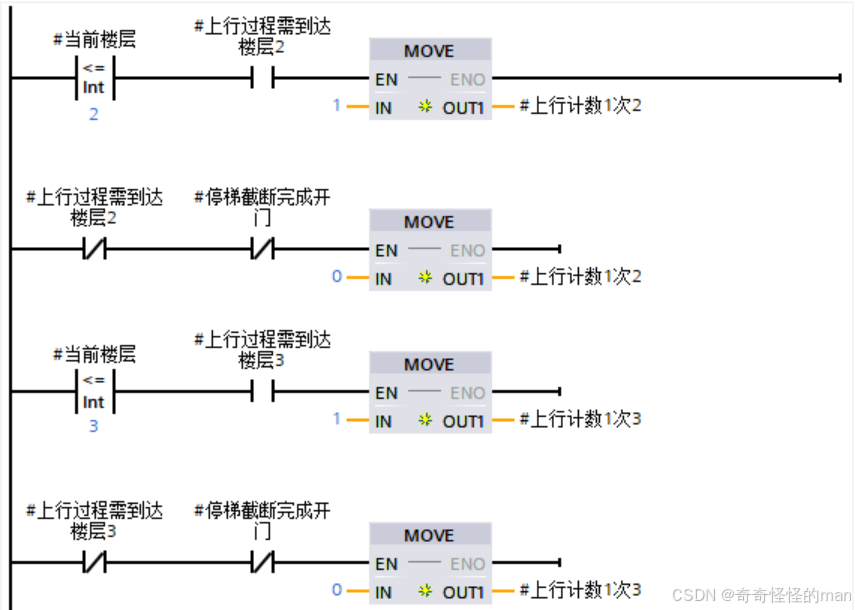
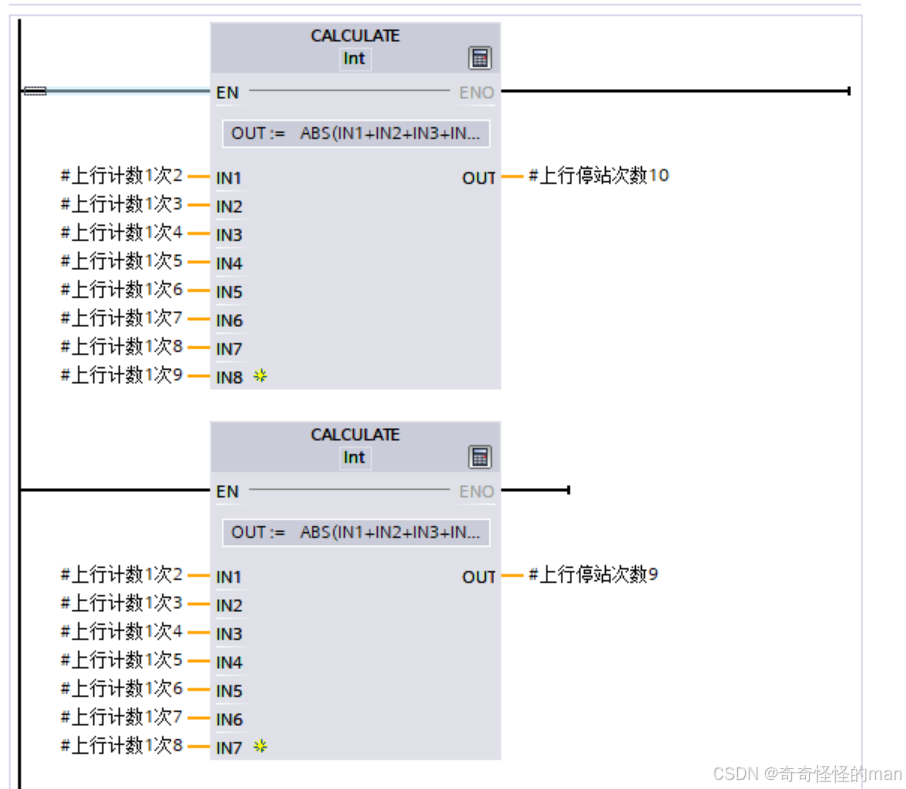
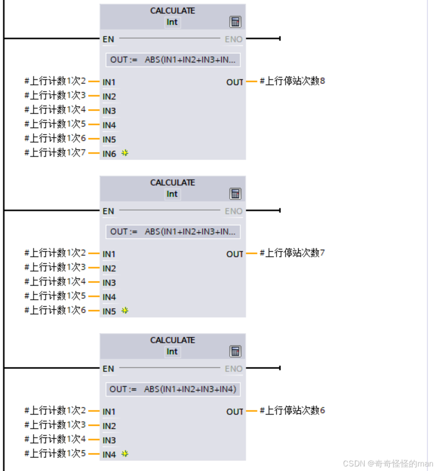
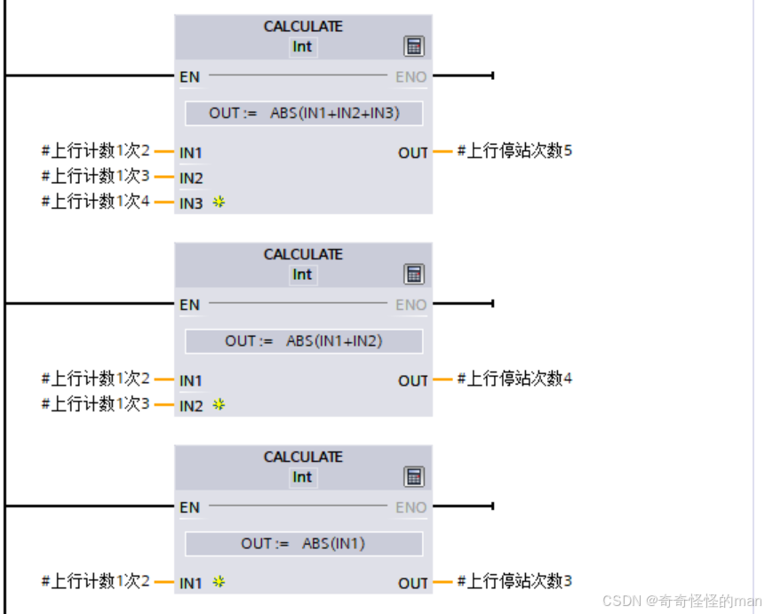
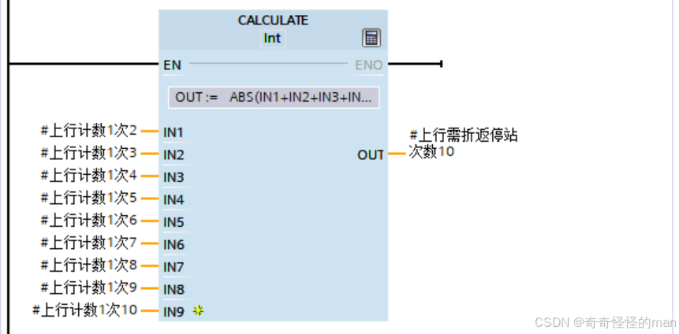

# 第 8 篇：停梯次数计算

> 原文发表于 2024-07-11，迁移至 GitHub 时进行了排版整理与附图本地化。
>
> **阅读说明**：文中 `代码格式` 表示程序变量名，**粗体**表示引用的 FC/FB 块，链接指向本系列相关章节。

在六部十层电梯群控调度中，评估一部电梯响应某个外呼请求到底“快不快”，不仅取决于楼层距离，还取决于**途经停站次数**（每次停梯加减速与开关门都会消耗大量时间）。本篇介绍单部电梯停站次数的统计思路，其计算结果直接输入下一篇[群控调度算法](09-dispatch-algorithm.md)。

---

## 一、单层停梯计数触发与清零

以 **2 层 / 3 层上行** 为例：
- 如图 1 所示，当存在外呼分配信号或轿厢内呼信号，且目标楼层大于当前电梯位置时，`上行过程需到达楼层2` / `上行过程需到达楼层3` 置位；
- 如图 2 所示，对应楼层的 `上行计数1次2` 置 `1`，待该层完成停梯截断（开关门结束）后复位为 `0`。

*图 1*

*图 2*

---

## 二、区间累计停站与折返停站次数统计

当电梯上行，且目标楼层位于 **3 ~ 10 层** 时（因为 1 ~ 2 层最多只有一次停梯，本身已是最短路径，无需额外对比；同理，下行方向需计算 **1 ~ 8 层**）：

将九段上行计数之和依次枚举统计出来后，进一步使用 `CALCULATE` 模块计算电梯需要折返时的总停站次数：

以上就是单部电梯停站次数的统计思路。由于六部电梯逻辑完全一致，建议**封装在 FB 块中编写，再在 FC 块中对 1 ~ 6 号电梯集中调用**，兼顾简洁性与可维护性。

> 如有问题或建议，欢迎在本仓库提交 [Issue](../../issues) 交流。

---

[← 上一篇：停梯优先级响应与开关电梯门](07-stop-priority-and-doors.md) | [返回项目主页](../README.md) | [下一篇：群控调度算法 →](09-dispatch-algorithm.md)
