# 第 9 篇：群控调度算法

> 原文发表于 2024-07-11，迁移至 GitHub 时进行了排版整理与附图本地化。
>
> **阅读说明**：文中 `代码格式` 表示程序变量名，**粗体**表示引用的 FC/FB 块，链接指向本系列相关章节。

---

## 一、电梯调度算法概述

电梯群控调度算法有许多经典策略可供选择，理论背景可参考本仓库附录[《群控电梯调度算法综述》](appendix-dispatch-algorithms.md)。本系统核心采用 **最短寻找楼层时间优先算法（SSTF）** 并结合停站权重与追击重分配机制进行工程优化。

在“西门子杯”比赛中，最终得分由多项考核指标共同决定：
- 是否准确完成[初始化](02-initialization.md)？
- 当某部电梯初始化检修时，是否点亮检修灯且隔离不参与群控？
- 电梯外呼信号多久能得到响应？每位乘客候梯与乘梯总耗时多长？
- 系统整体能耗比是否还能继续优化？

因此，在跑通单部电梯基础运动控制后，群控调度算法决定了整套系统的上限。本篇将调度算法拆分为两个核心模块展开：**距离调度** 与 **距离比较**。

---

## 二、距离调度

下面以 **2 层上呼指示灯亮** 为例（其余楼层上呼、下呼同理）。本系统根据电梯当前位置、运行方向及是否有反向任务，划分出 **五种分配触发原则**，利用中间变量实时计算等效调度距离：

### （1）顺向直达 / 同层停稳状态

- 当 2 层上呼灯亮，电梯处于下行状态且位于 2 层以下（1 层）时，`OUT1 = |当前楼层 - 2|`；
- 或者电梯处于上行/停稳状态且恰好停靠在 2 层及以下顺向位置时，`OUT1 = |当前楼层 - 2|`。

这是最基础的直达情况；下文情况（2）与（3）相对，情况（4）与（5）相对。

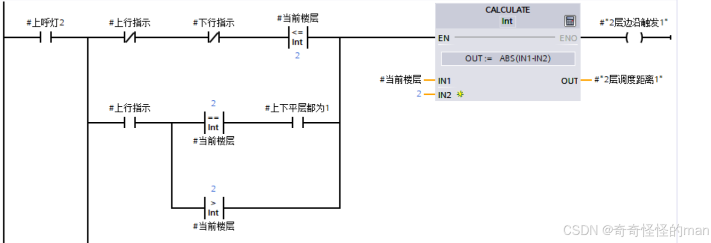

### （2）电梯下行且当前楼层以下无外呼目标

当 2 层上呼灯亮，电梯处于下行状态，且当前楼层以下无外呼目标时：

```text
OUT = ABS(IN1 - IN2) + IN3 + IN3
```

> 注：将 `下行停站次数`（`IN3`）累加两遍，相当于**增大停站耗时在调度代价函数中的权重**。`下行停站次数` 由上一篇[停梯次数计算](08-stop-count.md)写入。

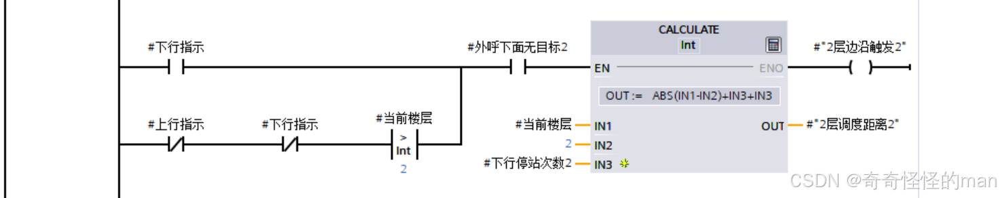

### （3）电梯下行且存在下外呼目标

当 2 层上呼灯亮，且当前存在下外呼折返任务时：

```text
OUT = ABS(IN3 + IN3 - IN1 - IN2) + IN5 + IN5 + IN6
```

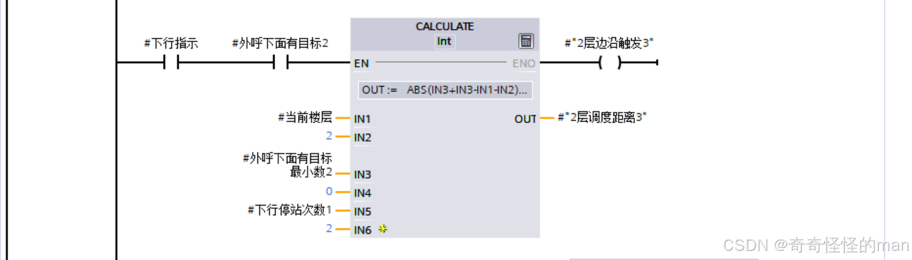

### （4 / 5）电梯位于 2 层及以上且处于非停靠运动状态

当 2 层上呼灯亮，电梯当前位置大于等于 2 层且不在停靠状态时，按是否存在下外呼目标分为两类：
- **a）下外呼有目标**：
  ```text
  OUT = ABS(IN3 - IN1 + IN3 - IN6 + IN2 - IN6) + IN4 + IN4 + IN7 + IN7 + IN8 + IN8
  ```
- **b）下外呼无目标**：
  ```text
  OUT = ABS(IN3 - IN1 + IN3 - IN2) + IN5 + IN4 + IN4 + IN5 + IN6
  ```

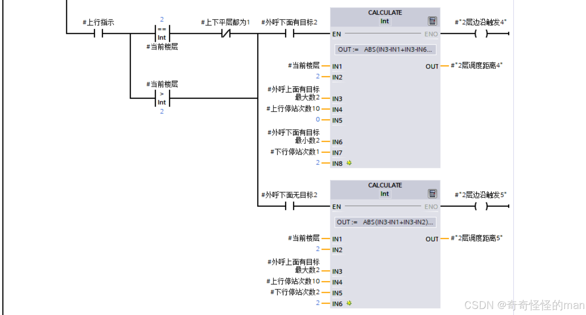

### 载重惩罚与防并列死机处理

大家不必拘泥于完全相同的权重系数，不同的权重配比会呈现出不同的接客响应风格，可以在仿真中多加对比测试。当系统计算完单部电梯的基础调度距离并触发边沿信号后，下一步是根据电梯当前载重赋予 **`最终调度距离`**（数值越小的电梯越优先被分配）：

以两类边沿触发信号变量为例：

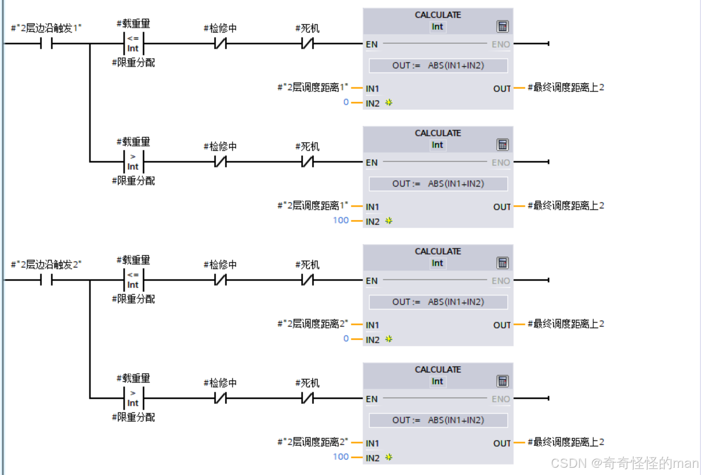

**梯形图分析**：
- 若电梯满载/超重则不参与外呼分配（令 `OUT = 楼层调度距离 + 100`）；
- 若电梯正常运行，则正常输出 `最终调度距离`，送入下一节与其他五部电梯横向比选。

在距离调度中最核心的是**完备的分类讨论**：在不同外呼分布（有外呼 / 无外呼）与不同运行方向（上行 / 下行）组合下，都必须通过边沿触发实时刷新存储值。同时，这一环节也最容易因**多部电梯计算出的距离完全相等**而引发抢单冲突或死机，因此一方面要拉开停站次数等指标的权重梯度（例如 1 号梯停靠 2 次、2 号梯停靠 4 次，`2` 与 `4` 相差 `2`，而双倍权重 `2+2` 与 `4+4` 相差 `4`），另一方面加入如下防死机与停运隔离逻辑：

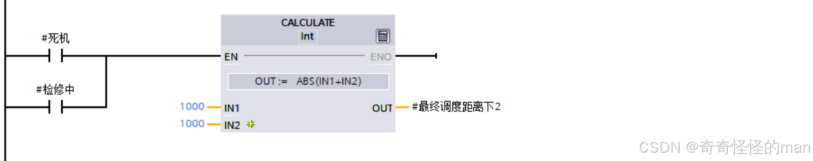

> **实战技巧**：在 Day 2 比赛中经常遇到“指定某部电梯停止运行（启停控制）”的要求，可以直接复用上图方法——**将该电梯的 `最终调度距离` 赋值为无穷大（极大常数）**，外呼信号自然就不会分配给这部电梯。

---

## 三、距离比较与动态重分配

### 3.1 比较并计算调度差值

这段逻辑非常直观：在六部电梯的 `最终调度距离` 中进行比较，选出代价值最小的那一部电梯承接该外呼请求：

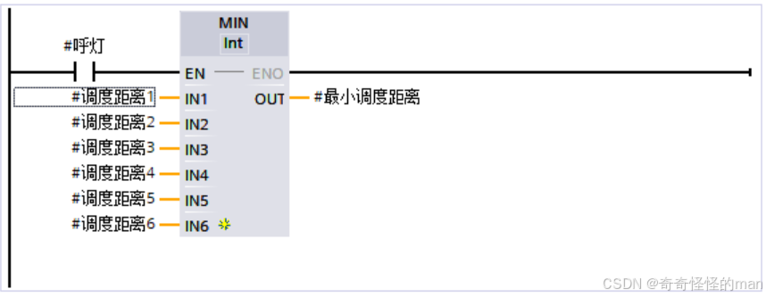

### 3.2 电梯之间的“追击问题”（动态抢单优化）

**追击问题**是对静态最短距离分配的一项重要动态优化：

> **场景举例**：假设 1 号梯位于 6 层下行，正要去 5 层接乘客，同时 3 层的下外呼也分配给了 1 号梯；此时 2 号梯位于 7 层，轿厢内有乘客想去 1 层。当 1 号梯在 5 层停梯开关门接客时，2 号梯由于中途无需停靠、高速直下，反而比 1 号梯更早到达 3 层——即 2 号梯“追上”了 1 号梯。此时让 2 号梯直接接管 1 号梯原本的 3 层下外呼任务并顺路带走乘客，整体候梯时间将大幅缩短。

为此，我们需要实时比较每一扫描周期两部电梯调度代价的差值，判断是否满足动态抢单条件：

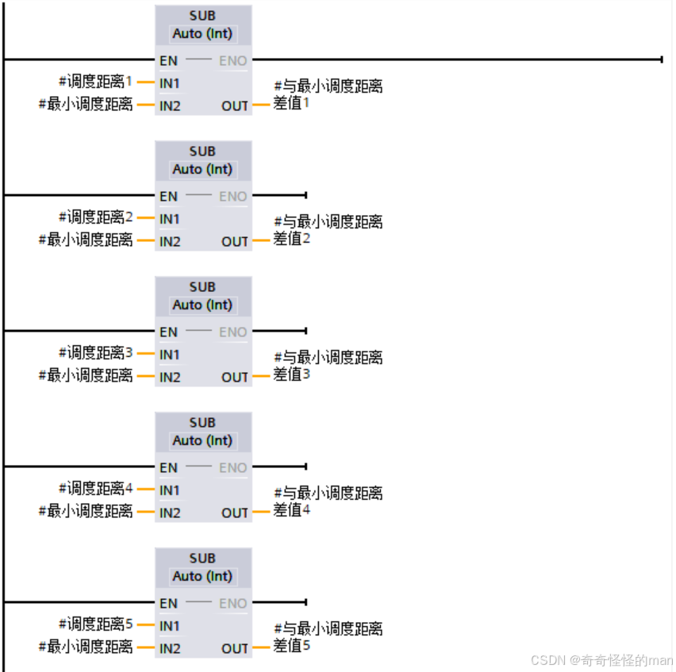

以 3 号梯的追击梯形图为例：

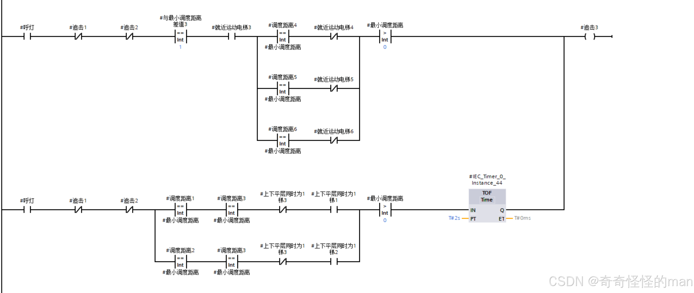

### 3.3 判断内外呼叫重合与最终分配外呼

当某部电梯运行至某楼层且轿厢内呼已包含该层时，检测到内外呼重合后将状态锁存在 `内外呼重合` 变量中：

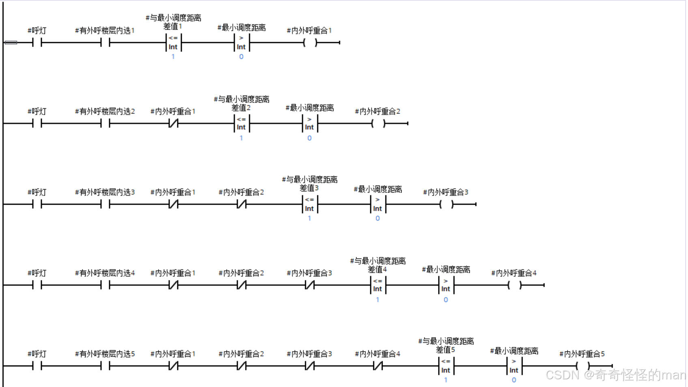

以 3 号梯为例，重合后直接将该层同向外呼并入 3 号梯响应；下方分配梯形图看起来较长，本质上是**六部电梯之间的互锁回路**，严格保证同一时刻一个外呼信号只被唯一一部电梯锁定（下图仅截取其中一小段，完整六梯互锁代码约为图示的六倍规模，结构对称但务必仔细核对变量编号避免冲突）：

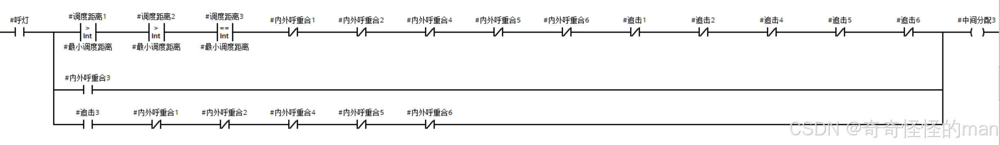

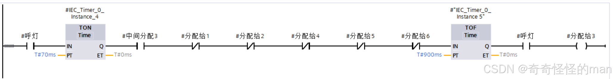

---

## 四、系列小结与学习资源推荐

至此，六部十层电梯从底层信号触发、楼层校准、三级制动、门控看门狗到顶层群控调度分配的核心问题均已梳理完毕（上位机画面与脚本详见下一篇[WinCC 组态与 VB 脚本](10-wincc-hmi-vbscript.md)）。如果能够把本系列各篇串联起来理解透彻，相信在赛场上定会更加得心应手。

回顾自己参赛的经历，当时尚未完全意识到早期代码中的潜在隐患（所幸比赛现场没有触发死机）；在赛后断断续续一年多复盘整理本系列文章的过程中，我对 PLC 工程架构也有了更加深刻的理解。比赛虽然名次留有遗憾，但复盘沉淀下来的收获远比名次本身更有价值，也希望这套专栏能真正帮到备战逻辑算法赛道的各位同学！

我最初入门自学时，是在 B 站跟着**米粒方糖**老师的八节培训课打下的基础，非常推荐有时间的同学系统观看：
- [智能制造挑战赛离散行业组培训（1） - 哔哩哔哩](https://www.bilibili.com/video/BV1hv4y1o7zC/)

> 如有问题或建议，欢迎在本仓库提交 [Issue](../../issues) 交流。

---

[← 上一篇：停梯次数计算](08-stop-count.md) | [返回项目主页](../README.md) | [下一篇：WinCC 组态与 VB 脚本 →](10-wincc-hmi-vbscript.md)
